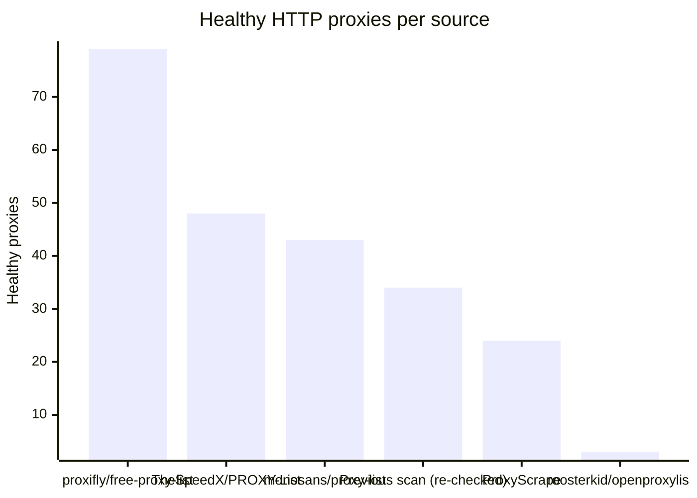
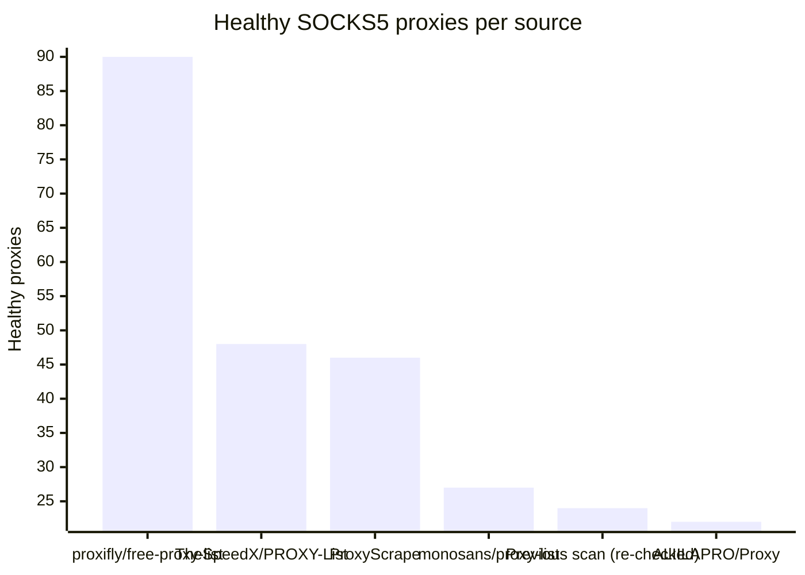

# Proxy Configs

<!-- dynamic timestamp placeholders for workflow sed script -->
channel_stats_chart.svg?v=1792432926
performance_report.html?v=1792432926

### Performance Chart

### Performance Report
[View Report](assets/performance_report.html?v=1792432926)

## HTTP

<!-- STATS:HTTP:START -->

_Last updated: 2026-10-19 12:21 UTC_

| Source | Healthy proxies |
|---|---|
| proxifly/free-proxy-list | 79 |
| TheSpeedX/PROXY-List | 48 |
| monosans/proxy-list | 43 |
| Previous scan (re-checked) | 34 |
| ProxyScrape | 24 |
| roosterkid/openproxylist | 3 |
| **Total unique** | **231** |

<!-- STATS:HTTP:END -->

## SOCKS5

<!-- STATS:SOCKS5:START -->

_Last updated: 2026-10-19 12:21 UTC_

| Source | Healthy proxies |
|---|---|
| proxifly/free-proxy-list | 90 |
| TheSpeedX/PROXY-List | 48 |
| ProxyScrape | 46 |
| monosans/proxy-list | 27 |
| Previous scan (re-checked) | 24 |
| ALIILAPRO/Proxy | 22 |
| **Total unique** | **257** |

<!-- STATS:SOCKS5:END -->
