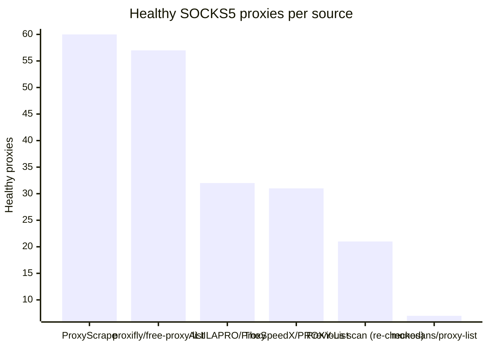

# Proxy Configs

<!-- dynamic timestamp placeholders for workflow sed script -->
channel_stats_chart.svg?v=1794549840
performance_report.html?v=1794549840

### Performance Chart

### Performance Report
[View Report](assets/performance_report.html?v=1794549840)

## HTTP

<!-- STATS:HTTP:START -->

_Last updated: 2026-11-13 00:13 UTC_

| Source | Healthy proxies |
|---|---|
| proxifly/free-proxy-list | 85 |
| Previous scan (re-checked) | 46 |
| monosans/proxy-list | 45 |
| TheSpeedX/PROXY-List | 44 |
| ProxyScrape | 26 |
| ALIILAPRO/Proxy | 15 |
| roosterkid/openproxylist | 1 |
| **Total unique** | **262** |

<!-- STATS:HTTP:END -->

## SOCKS5

<!-- STATS:SOCKS5:START -->

_Last updated: 2026-11-13 00:13 UTC_

| Source | Healthy proxies |
|---|---|
| ProxyScrape | 60 |
| proxifly/free-proxy-list | 57 |
| ALIILAPRO/Proxy | 32 |
| TheSpeedX/PROXY-List | 31 |
| Previous scan (re-checked) | 21 |
| monosans/proxy-list | 7 |
| **Total unique** | **208** |

<!-- STATS:SOCKS5:END -->
