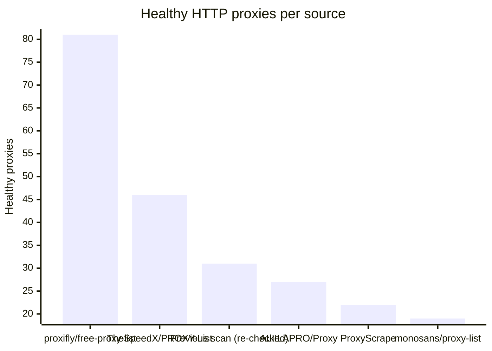
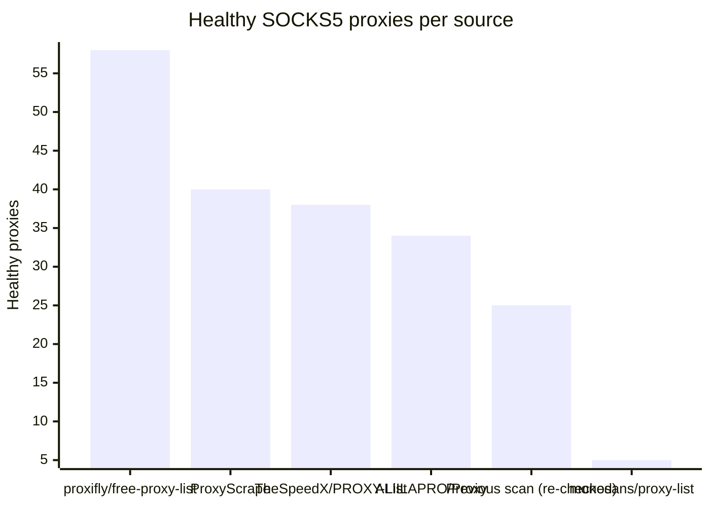

# Proxy Configs

<!-- dynamic timestamp placeholders for workflow sed script -->
channel_stats_chart.svg?v=1794074651
performance_report.html?v=1794074651

### Performance Chart

### Performance Report
[View Report](assets/performance_report.html?v=1794074651)

## HTTP

<!-- STATS:HTTP:START -->

_Last updated: 2026-11-07 12:16 UTC_

| Source | Healthy proxies |
|---|---|
| proxifly/free-proxy-list | 81 |
| TheSpeedX/PROXY-List | 46 |
| Previous scan (re-checked) | 31 |
| ALIILAPRO/Proxy | 27 |
| ProxyScrape | 22 |
| monosans/proxy-list | 19 |
| **Total unique** | **226** |

<!-- STATS:HTTP:END -->

## SOCKS5

<!-- STATS:SOCKS5:START -->

_Last updated: 2026-11-07 12:16 UTC_

| Source | Healthy proxies |
|---|---|
| proxifly/free-proxy-list | 58 |
| ProxyScrape | 40 |
| TheSpeedX/PROXY-List | 38 |
| ALIILAPRO/Proxy | 34 |
| Previous scan (re-checked) | 25 |
| monosans/proxy-list | 5 |
| **Total unique** | **200** |

<!-- STATS:SOCKS5:END -->
