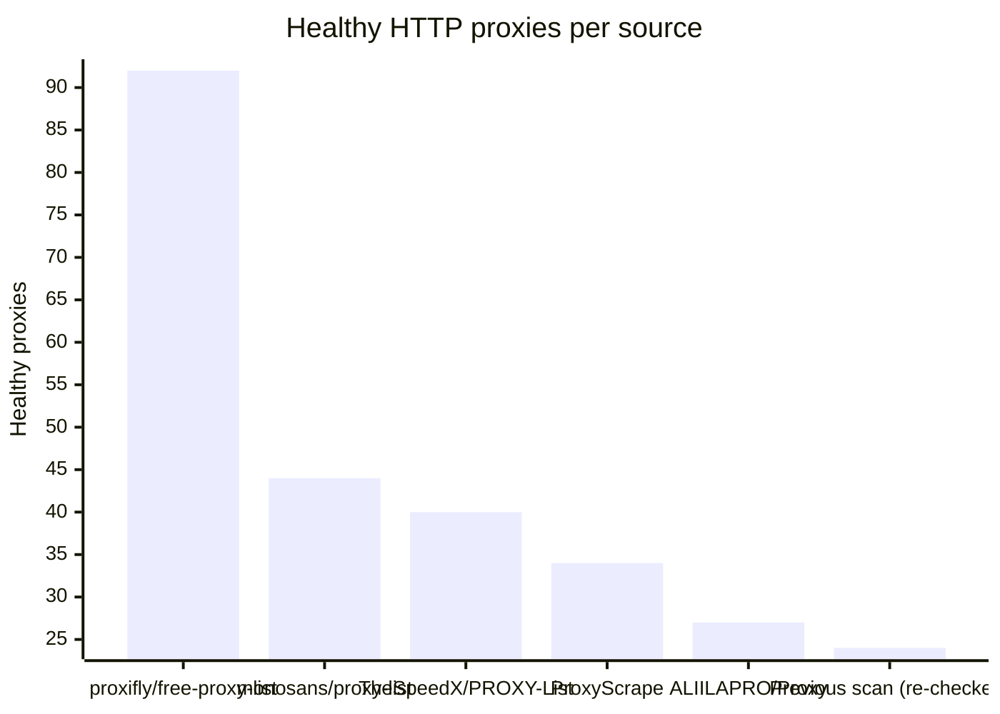
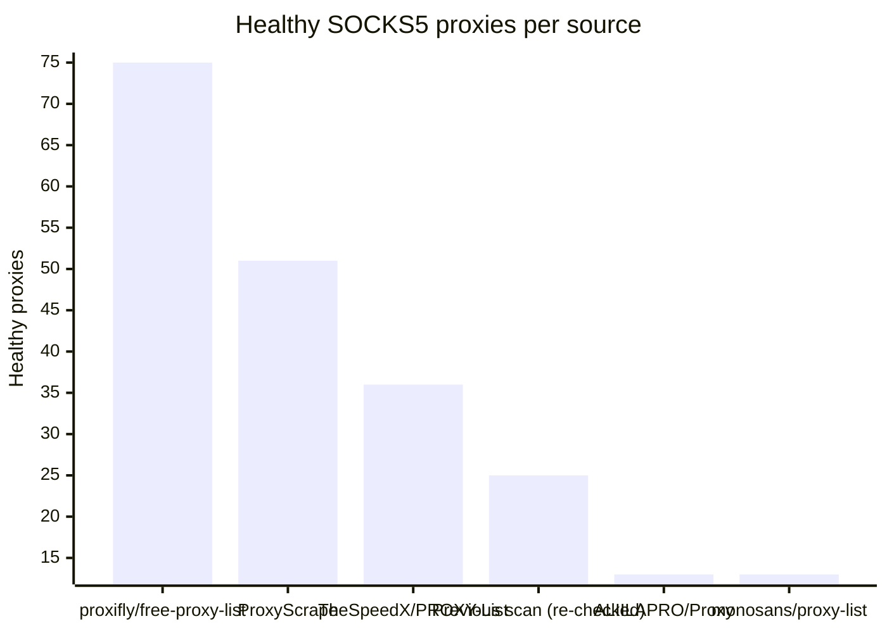

# Proxy Configs

<!-- dynamic timestamp placeholders for workflow sed script -->
channel_stats_chart.svg?v=1794052951
performance_report.html?v=1794052951

### Performance Chart

### Performance Report
[View Report](assets/performance_report.html?v=1794052951)

## HTTP

<!-- STATS:HTTP:START -->

_Last updated: 2026-11-07 06:18 UTC_

| Source | Healthy proxies |
|---|---|
| proxifly/free-proxy-list | 92 |
| monosans/proxy-list | 44 |
| TheSpeedX/PROXY-List | 40 |
| ProxyScrape | 34 |
| ALIILAPRO/Proxy | 27 |
| Previous scan (re-checked) | 24 |
| **Total unique** | **261** |

<!-- STATS:HTTP:END -->

## SOCKS5

<!-- STATS:SOCKS5:START -->

_Last updated: 2026-11-07 06:18 UTC_

| Source | Healthy proxies |
|---|---|
| proxifly/free-proxy-list | 75 |
| ProxyScrape | 51 |
| TheSpeedX/PROXY-List | 36 |
| Previous scan (re-checked) | 25 |
| ALIILAPRO/Proxy | 13 |
| monosans/proxy-list | 13 |
| **Total unique** | **213** |

<!-- STATS:SOCKS5:END -->
