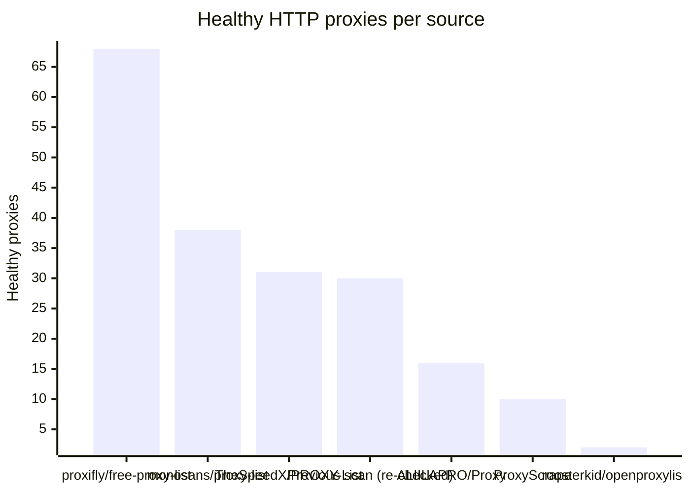
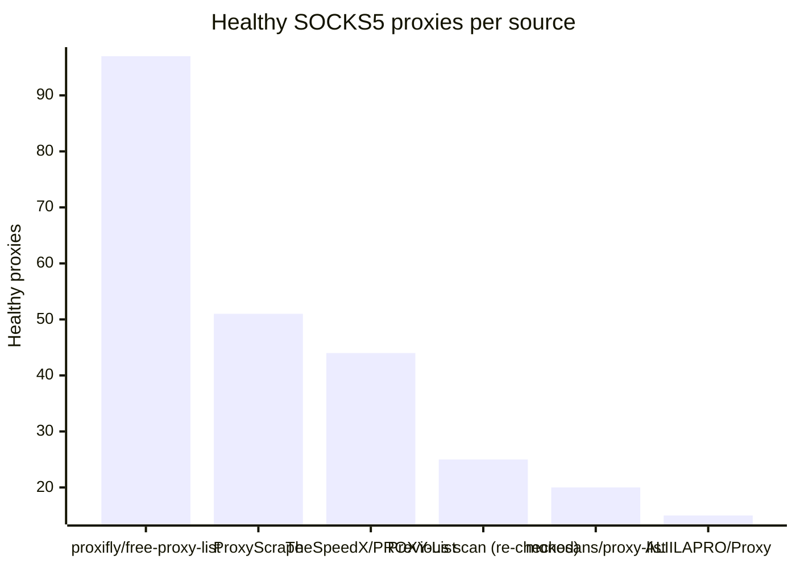

# Proxy Configs

<!-- dynamic timestamp placeholders for workflow sed script -->
channel_stats_chart.svg?v=1791871386
performance_report.html?v=1791871386

### Performance Chart

### Performance Report
[View Report](assets/performance_report.html?v=1791871386)

## HTTP

<!-- STATS:HTTP:START -->

_Last updated: 2026-10-13 00:23 UTC_

| Source | Healthy proxies |
|---|---|
| proxifly/free-proxy-list | 68 |
| monosans/proxy-list | 38 |
| TheSpeedX/PROXY-List | 31 |
| Previous scan (re-checked) | 30 |
| ALIILAPRO/Proxy | 16 |
| ProxyScrape | 10 |
| roosterkid/openproxylist | 2 |
| **Total unique** | **195** |

<!-- STATS:HTTP:END -->

## SOCKS5

<!-- STATS:SOCKS5:START -->

_Last updated: 2026-10-13 00:23 UTC_

| Source | Healthy proxies |
|---|---|
| proxifly/free-proxy-list | 97 |
| ProxyScrape | 51 |
| TheSpeedX/PROXY-List | 44 |
| Previous scan (re-checked) | 25 |
| monosans/proxy-list | 20 |
| ALIILAPRO/Proxy | 15 |
| **Total unique** | **252** |

<!-- STATS:SOCKS5:END -->
