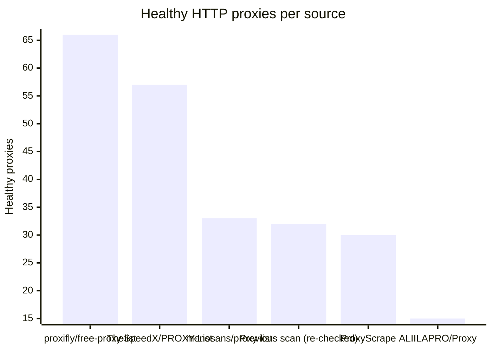
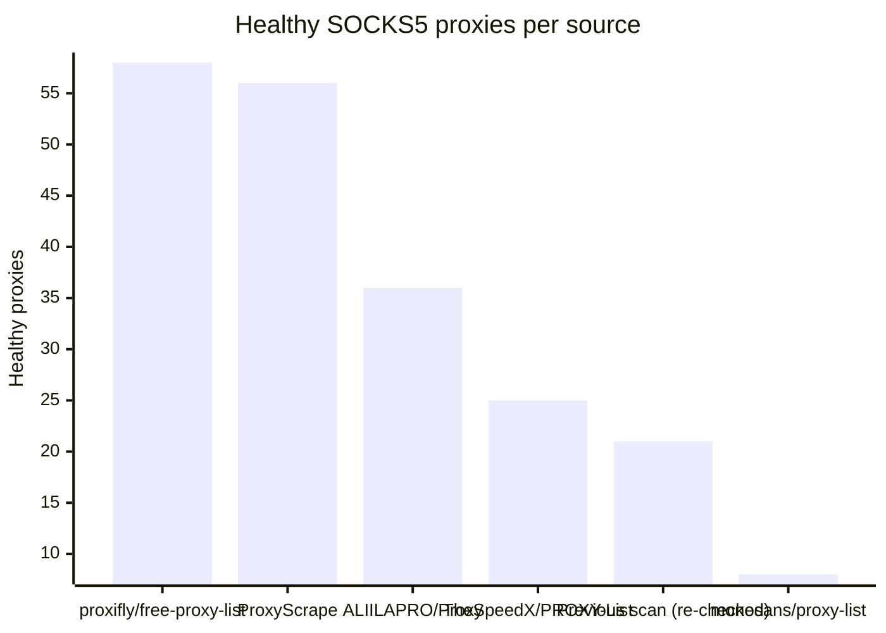

# Proxy Configs

<!-- dynamic timestamp placeholders for workflow sed script -->
channel_stats_chart.svg?v=1794722593
performance_report.html?v=1794722593

### Performance Chart

### Performance Report
[View Report](assets/performance_report.html?v=1794722593)

## HTTP

<!-- STATS:HTTP:START -->

_Last updated: 2026-11-15 00:12 UTC_

| Source | Healthy proxies |
|---|---|
| proxifly/free-proxy-list | 66 |
| TheSpeedX/PROXY-List | 57 |
| monosans/proxy-list | 33 |
| Previous scan (re-checked) | 32 |
| ProxyScrape | 30 |
| ALIILAPRO/Proxy | 15 |
| **Total unique** | **233** |

<!-- STATS:HTTP:END -->

## SOCKS5

<!-- STATS:SOCKS5:START -->

_Last updated: 2026-11-15 00:12 UTC_

| Source | Healthy proxies |
|---|---|
| proxifly/free-proxy-list | 58 |
| ProxyScrape | 56 |
| ALIILAPRO/Proxy | 36 |
| TheSpeedX/PROXY-List | 25 |
| Previous scan (re-checked) | 21 |
| monosans/proxy-list | 8 |
| **Total unique** | **204** |

<!-- STATS:SOCKS5:END -->
