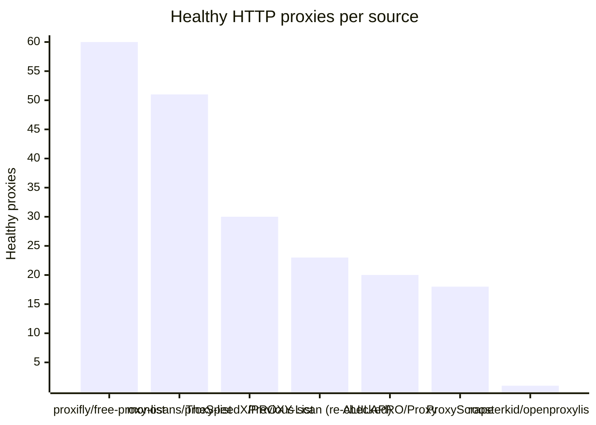
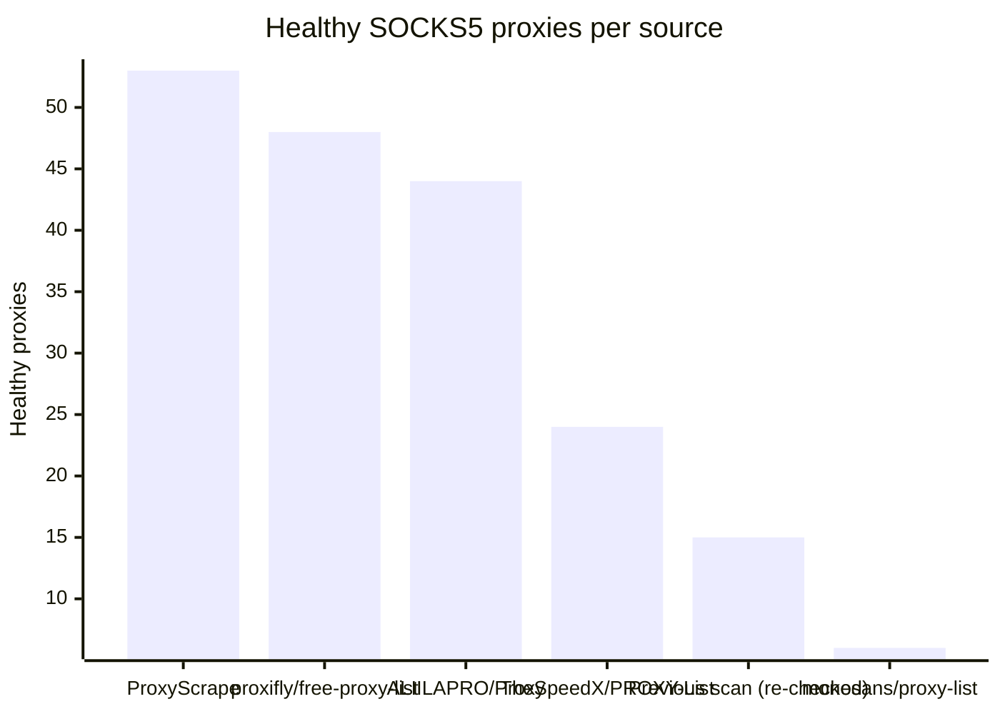

# Proxy Configs

<!-- dynamic timestamp placeholders for workflow sed script -->
channel_stats_chart.svg?v=1794700945
performance_report.html?v=1794700945

### Performance Chart

### Performance Report
[View Report](assets/performance_report.html?v=1794700945)

## HTTP

<!-- STATS:HTTP:START -->

_Last updated: 2026-11-14 18:12 UTC_

| Source | Healthy proxies |
|---|---|
| proxifly/free-proxy-list | 60 |
| monosans/proxy-list | 51 |
| TheSpeedX/PROXY-List | 30 |
| Previous scan (re-checked) | 23 |
| ALIILAPRO/Proxy | 20 |
| ProxyScrape | 18 |
| roosterkid/openproxylist | 1 |
| **Total unique** | **203** |

<!-- STATS:HTTP:END -->

## SOCKS5

<!-- STATS:SOCKS5:START -->

_Last updated: 2026-11-14 18:12 UTC_

| Source | Healthy proxies |
|---|---|
| ProxyScrape | 53 |
| proxifly/free-proxy-list | 48 |
| ALIILAPRO/Proxy | 44 |
| TheSpeedX/PROXY-List | 24 |
| Previous scan (re-checked) | 15 |
| monosans/proxy-list | 6 |
| **Total unique** | **190** |

<!-- STATS:SOCKS5:END -->
