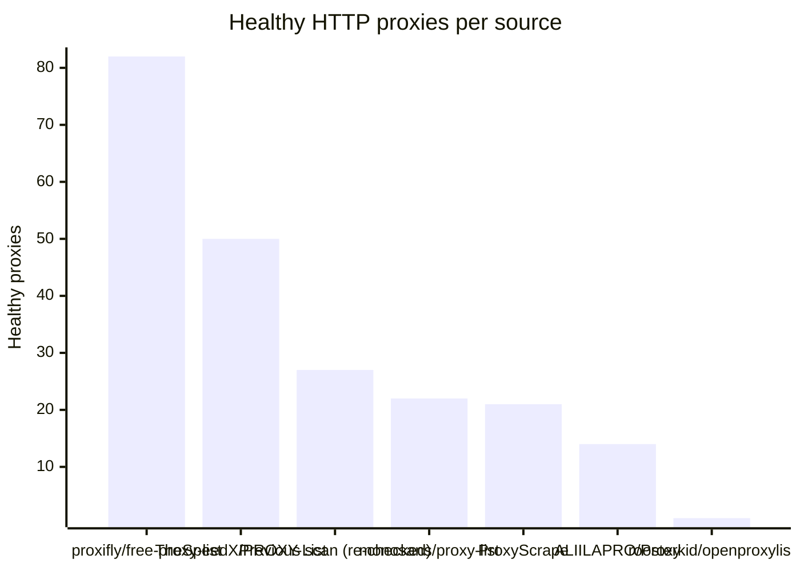
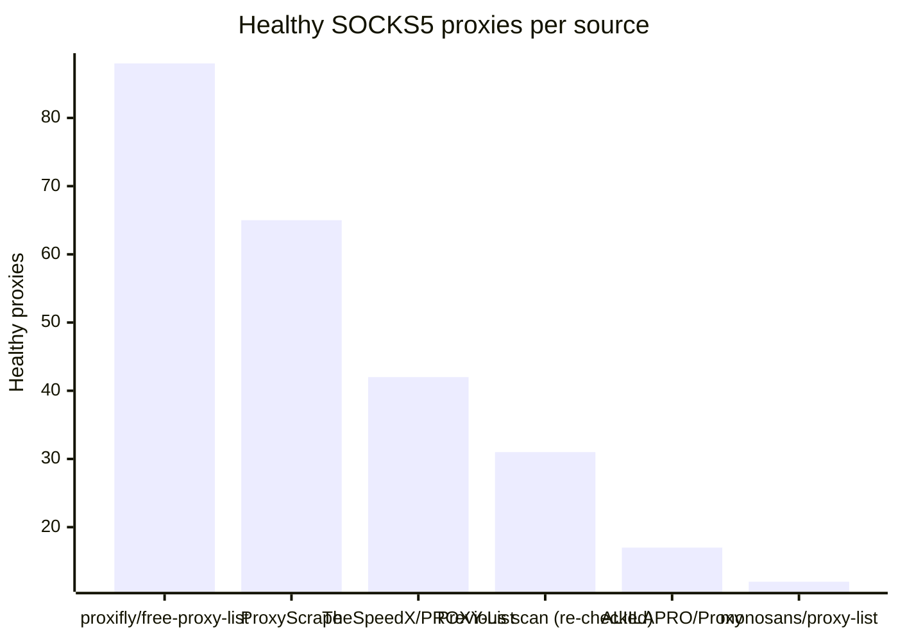

# Proxy Configs

<!-- dynamic timestamp placeholders for workflow sed script -->
channel_stats_chart.svg?v=1791309724
performance_report.html?v=1791309724

### Performance Chart

### Performance Report
[View Report](assets/performance_report.html?v=1791309724)

## HTTP

<!-- STATS:HTTP:START -->

_Last updated: 2026-11-20 06:14 UTC_

| Source | Healthy proxies |
|---|---|
| proxifly/free-proxy-list | 82 |
| TheSpeedX/PROXY-List | 50 |
| Previous scan (re-checked) | 27 |
| monosans/proxy-list | 22 |
| ProxyScrape | 21 |
| ALIILAPRO/Proxy | 14 |
| roosterkid/openproxylist | 1 |
| **Total unique** | **217** |

<!-- STATS:HTTP:END -->

## SOCKS5

<!-- STATS:SOCKS5:START -->

_Last updated: 2026-11-20 06:14 UTC_

| Source | Healthy proxies |
|---|---|
| proxifly/free-proxy-list | 88 |
| ProxyScrape | 65 |
| TheSpeedX/PROXY-List | 42 |
| Previous scan (re-checked) | 31 |
| ALIILAPRO/Proxy | 17 |
| monosans/proxy-list | 12 |
| **Total unique** | **255** |

<!-- STATS:SOCKS5:END -->
