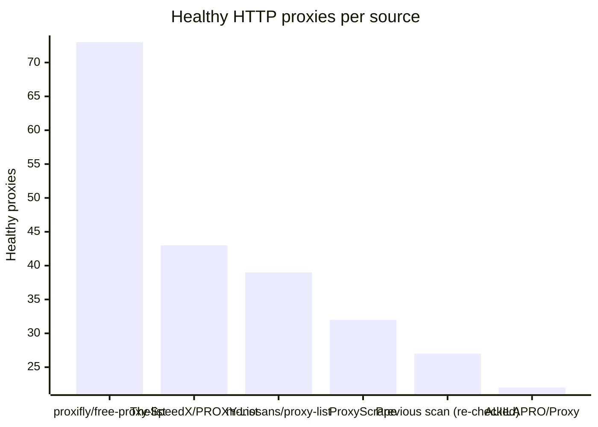
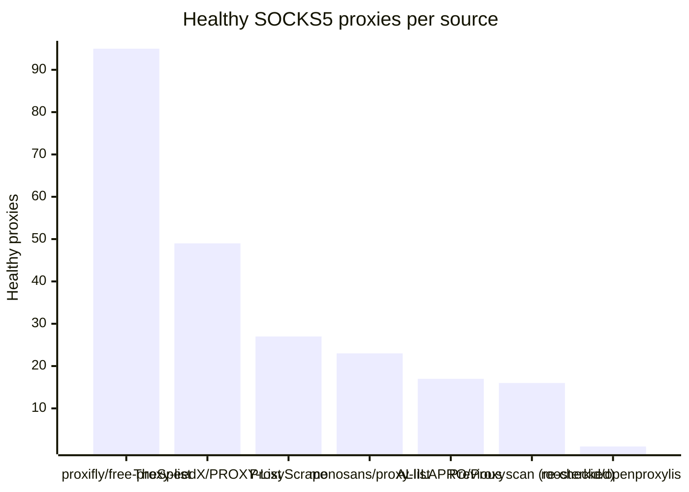

# Proxy Configs

<!-- dynamic timestamp placeholders for workflow sed script -->
channel_stats_chart.svg?v=1792757088
performance_report.html?v=1792757088

### Performance Chart

### Performance Report
[View Report](assets/performance_report.html?v=1792757088)

## HTTP

<!-- STATS:HTTP:START -->

_Last updated: 2026-10-23 07:58 UTC_

| Source | Healthy proxies |
|---|---|
| proxifly/free-proxy-list | 73 |
| TheSpeedX/PROXY-List | 43 |
| monosans/proxy-list | 39 |
| ProxyScrape | 32 |
| Previous scan (re-checked) | 27 |
| ALIILAPRO/Proxy | 22 |
| **Total unique** | **236** |

<!-- STATS:HTTP:END -->

## SOCKS5

<!-- STATS:SOCKS5:START -->

_Last updated: 2026-10-23 07:58 UTC_

| Source | Healthy proxies |
|---|---|
| proxifly/free-proxy-list | 95 |
| TheSpeedX/PROXY-List | 49 |
| ProxyScrape | 27 |
| monosans/proxy-list | 23 |
| ALIILAPRO/Proxy | 17 |
| Previous scan (re-checked) | 16 |
| roosterkid/openproxylist | 1 |
| **Total unique** | **228** |

<!-- STATS:SOCKS5:END -->
