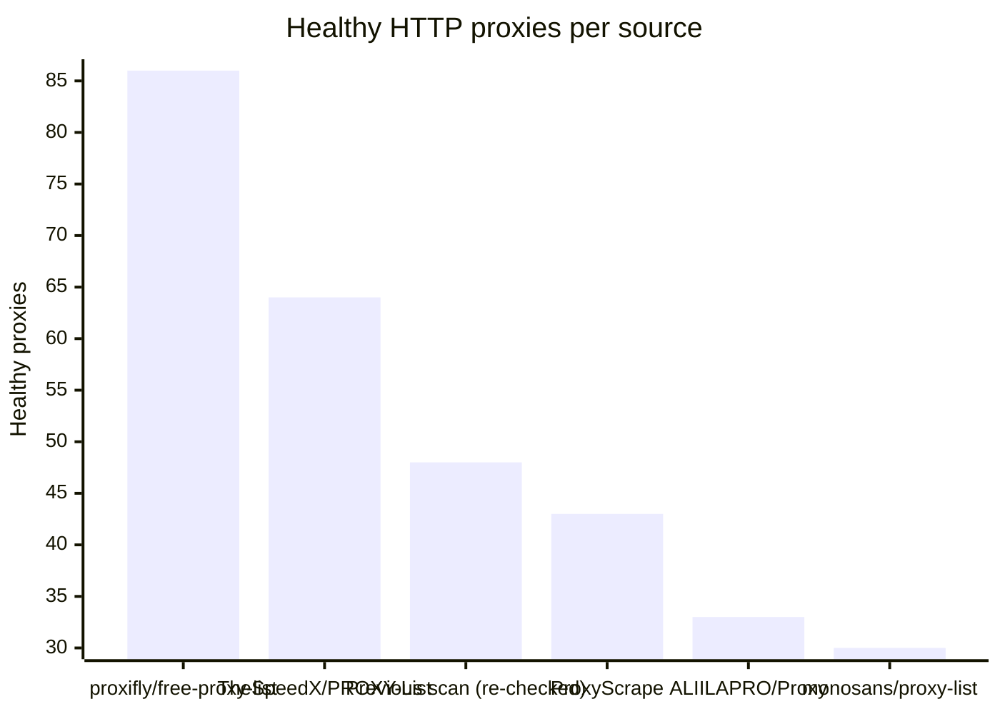
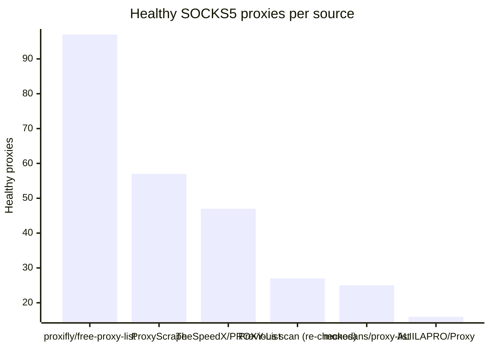

# Proxy Configs

<!-- dynamic timestamp placeholders for workflow sed script -->
channel_stats_chart.svg?v=1791720173
performance_report.html?v=1791720173

### Performance Chart

### Performance Report
[View Report](assets/performance_report.html?v=1791720173)

## HTTP

<!-- STATS:HTTP:START -->

_Last updated: 2026-10-11 06:20 UTC_

| Source | Healthy proxies |
|---|---|
| proxifly/free-proxy-list | 86 |
| TheSpeedX/PROXY-List | 64 |
| Previous scan (re-checked) | 48 |
| ProxyScrape | 43 |
| ALIILAPRO/Proxy | 33 |
| monosans/proxy-list | 30 |
| **Total unique** | **304** |

<!-- STATS:HTTP:END -->

## SOCKS5

<!-- STATS:SOCKS5:START -->

_Last updated: 2026-10-11 06:20 UTC_

| Source | Healthy proxies |
|---|---|
| proxifly/free-proxy-list | 97 |
| ProxyScrape | 57 |
| TheSpeedX/PROXY-List | 47 |
| Previous scan (re-checked) | 27 |
| monosans/proxy-list | 25 |
| ALIILAPRO/Proxy | 16 |
| **Total unique** | **269** |

<!-- STATS:SOCKS5:END -->
