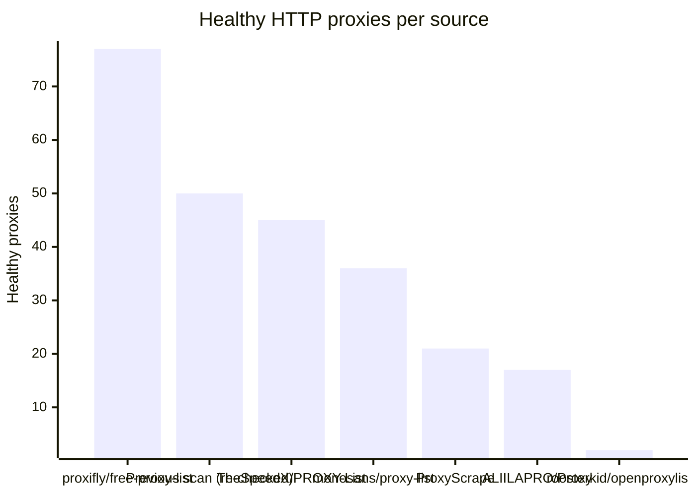
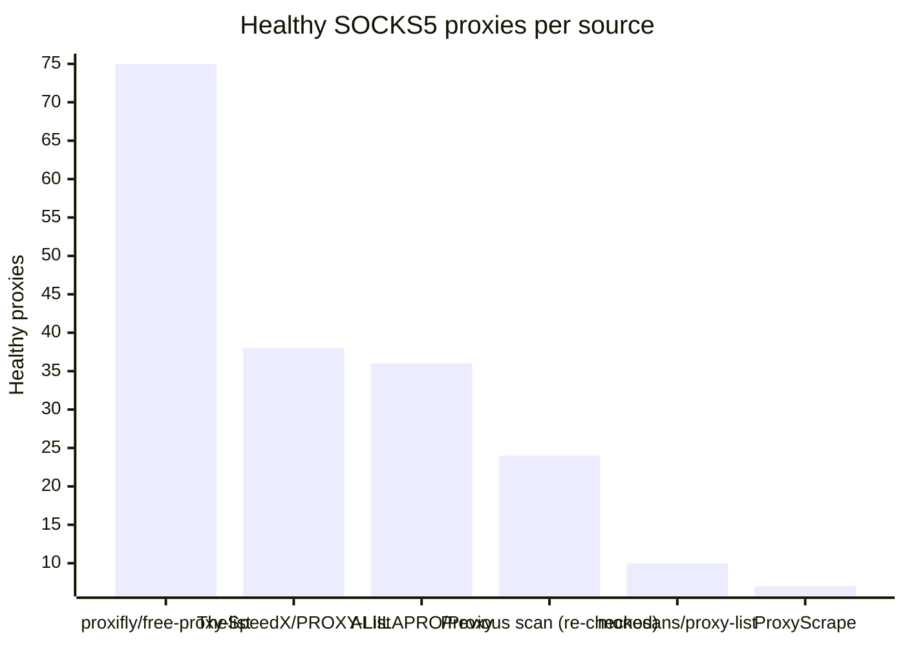

# Proxy Configs

<!-- dynamic timestamp placeholders for workflow sed script -->
channel_stats_chart.svg?v=1794744154
performance_report.html?v=1794744154

### Performance Chart

### Performance Report
[View Report](assets/performance_report.html?v=1794744154)

## HTTP

<!-- STATS:HTTP:START -->

_Last updated: 2026-11-15 06:13 UTC_

| Source | Healthy proxies |
|---|---|
| proxifly/free-proxy-list | 77 |
| Previous scan (re-checked) | 50 |
| TheSpeedX/PROXY-List | 45 |
| monosans/proxy-list | 36 |
| ProxyScrape | 21 |
| ALIILAPRO/Proxy | 17 |
| roosterkid/openproxylist | 2 |
| **Total unique** | **248** |

<!-- STATS:HTTP:END -->

## SOCKS5

<!-- STATS:SOCKS5:START -->

_Last updated: 2026-11-15 06:13 UTC_

| Source | Healthy proxies |
|---|---|
| proxifly/free-proxy-list | 75 |
| TheSpeedX/PROXY-List | 38 |
| ALIILAPRO/Proxy | 36 |
| Previous scan (re-checked) | 24 |
| monosans/proxy-list | 10 |
| ProxyScrape | 7 |
| **Total unique** | **190** |

<!-- STATS:SOCKS5:END -->
