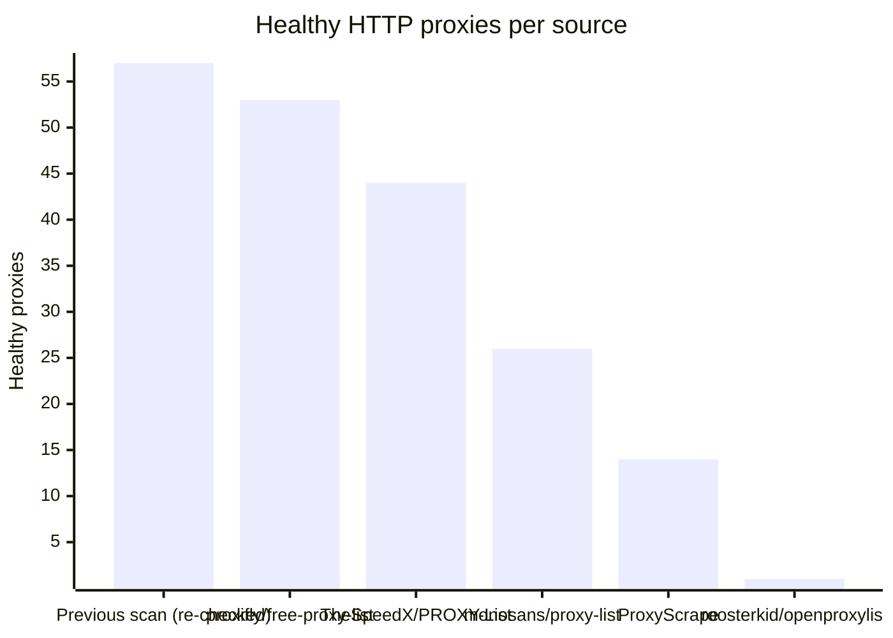
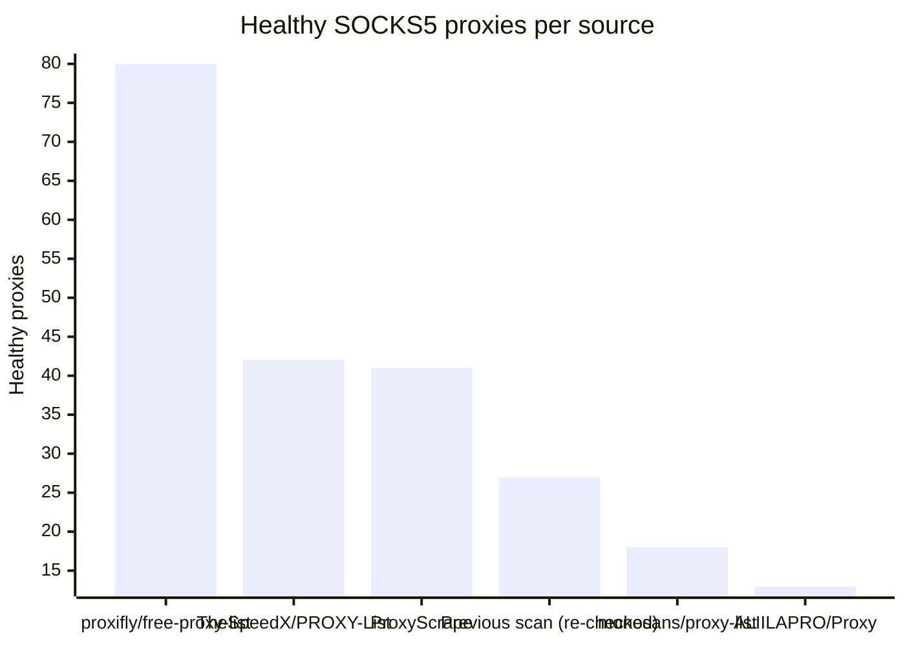

# Proxy Configs

<!-- dynamic timestamp placeholders for workflow sed script -->
channel_stats_chart.svg?v=1795824131
performance_report.html?v=1795824131

### Performance Chart

### Performance Report
[View Report](assets/performance_report.html?v=1795824131)

## HTTP

<!-- STATS:HTTP:START -->

_Last updated: 2026-11-27 18:13 UTC_

| Source | Healthy proxies |
|---|---|
| Previous scan (re-checked) | 57 |
| proxifly/free-proxy-list | 53 |
| TheSpeedX/PROXY-List | 44 |
| monosans/proxy-list | 26 |
| ProxyScrape | 14 |
| roosterkid/openproxylist | 1 |
| **Total unique** | **195** |

<!-- STATS:HTTP:END -->

## SOCKS5

<!-- STATS:SOCKS5:START -->

_Last updated: 2026-11-27 18:13 UTC_

| Source | Healthy proxies |
|---|---|
| proxifly/free-proxy-list | 80 |
| TheSpeedX/PROXY-List | 42 |
| ProxyScrape | 41 |
| Previous scan (re-checked) | 27 |
| monosans/proxy-list | 18 |
| ALIILAPRO/Proxy | 13 |
| **Total unique** | **221** |

<!-- STATS:SOCKS5:END -->
