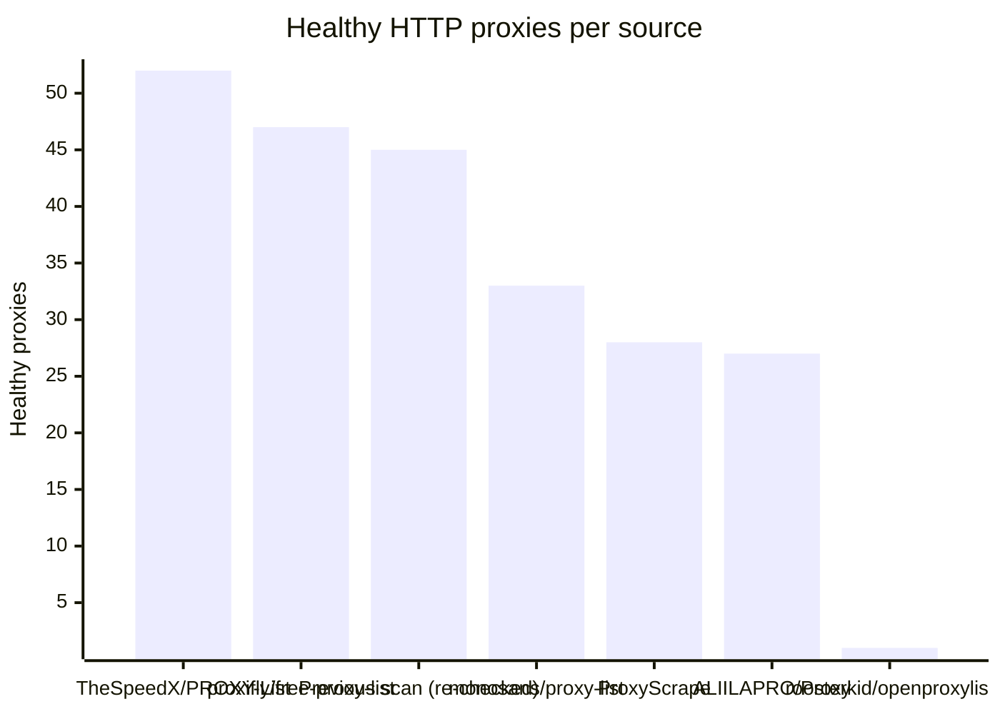
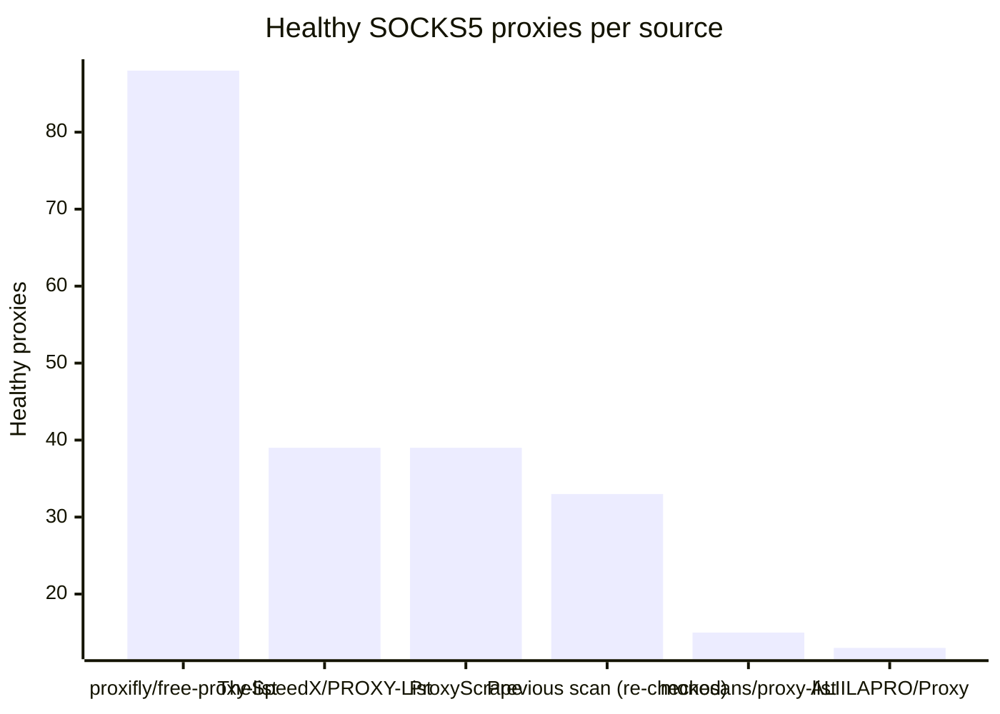

# Proxy Configs

<!-- dynamic timestamp placeholders for workflow sed script -->
channel_stats_chart.svg?v=1795845722
performance_report.html?v=1795845722

### Performance Chart

### Performance Report
[View Report](assets/performance_report.html?v=1795845722)

## HTTP

<!-- STATS:HTTP:START -->

_Last updated: 2026-11-28 00:11 UTC_

| Source | Healthy proxies |
|---|---|
| TheSpeedX/PROXY-List | 52 |
| proxifly/free-proxy-list | 47 |
| Previous scan (re-checked) | 45 |
| monosans/proxy-list | 33 |
| ProxyScrape | 28 |
| ALIILAPRO/Proxy | 27 |
| roosterkid/openproxylist | 1 |
| **Total unique** | **233** |

<!-- STATS:HTTP:END -->

## SOCKS5

<!-- STATS:SOCKS5:START -->

_Last updated: 2026-11-28 00:11 UTC_

| Source | Healthy proxies |
|---|---|
| proxifly/free-proxy-list | 88 |
| TheSpeedX/PROXY-List | 39 |
| ProxyScrape | 39 |
| Previous scan (re-checked) | 33 |
| monosans/proxy-list | 15 |
| ALIILAPRO/Proxy | 13 |
| **Total unique** | **227** |

<!-- STATS:SOCKS5:END -->
