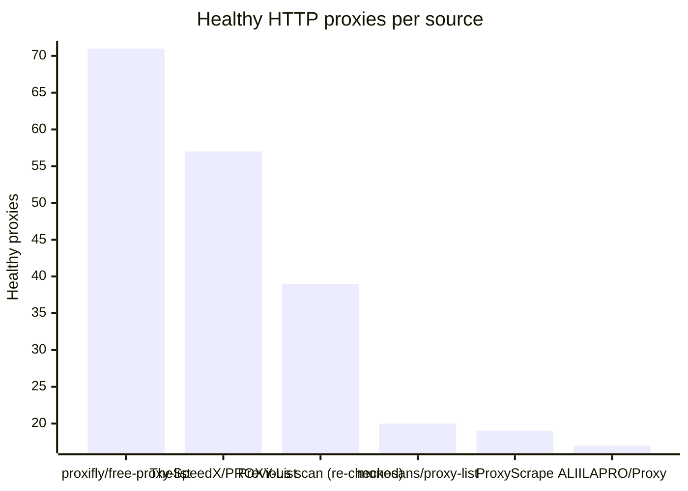
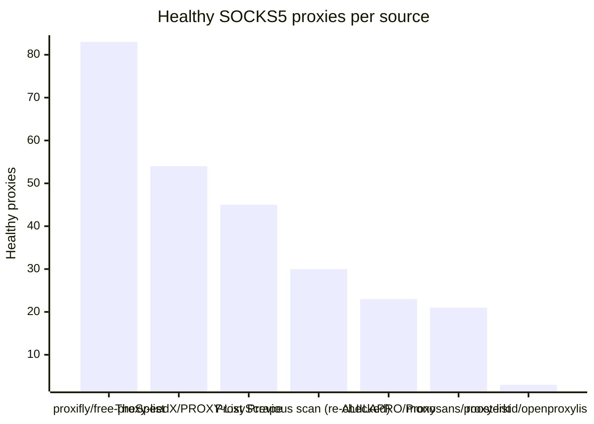

# Proxy Configs

<!-- dynamic timestamp placeholders for workflow sed script -->
channel_stats_chart.svg?v=1795694702
performance_report.html?v=1795694702

### Performance Chart

### Performance Report
[View Report](assets/performance_report.html?v=1795694702)

## HTTP

<!-- STATS:HTTP:START -->

_Last updated: 2026-11-26 06:13 UTC_

| Source | Healthy proxies |
|---|---|
| proxifly/free-proxy-list | 71 |
| TheSpeedX/PROXY-List | 57 |
| Previous scan (re-checked) | 39 |
| monosans/proxy-list | 20 |
| ProxyScrape | 19 |
| ALIILAPRO/Proxy | 17 |
| **Total unique** | **223** |

<!-- STATS:HTTP:END -->

## SOCKS5

<!-- STATS:SOCKS5:START -->

_Last updated: 2026-11-26 06:13 UTC_

| Source | Healthy proxies |
|---|---|
| proxifly/free-proxy-list | 83 |
| TheSpeedX/PROXY-List | 54 |
| ProxyScrape | 45 |
| Previous scan (re-checked) | 30 |
| ALIILAPRO/Proxy | 23 |
| monosans/proxy-list | 21 |
| roosterkid/openproxylist | 3 |
| **Total unique** | **259** |

<!-- STATS:SOCKS5:END -->
