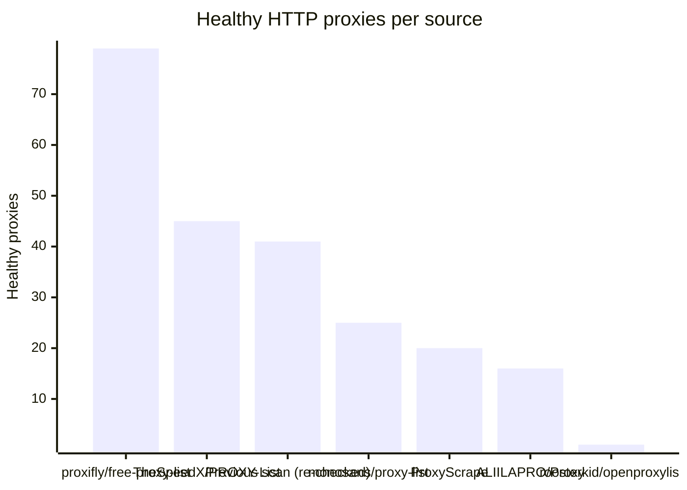
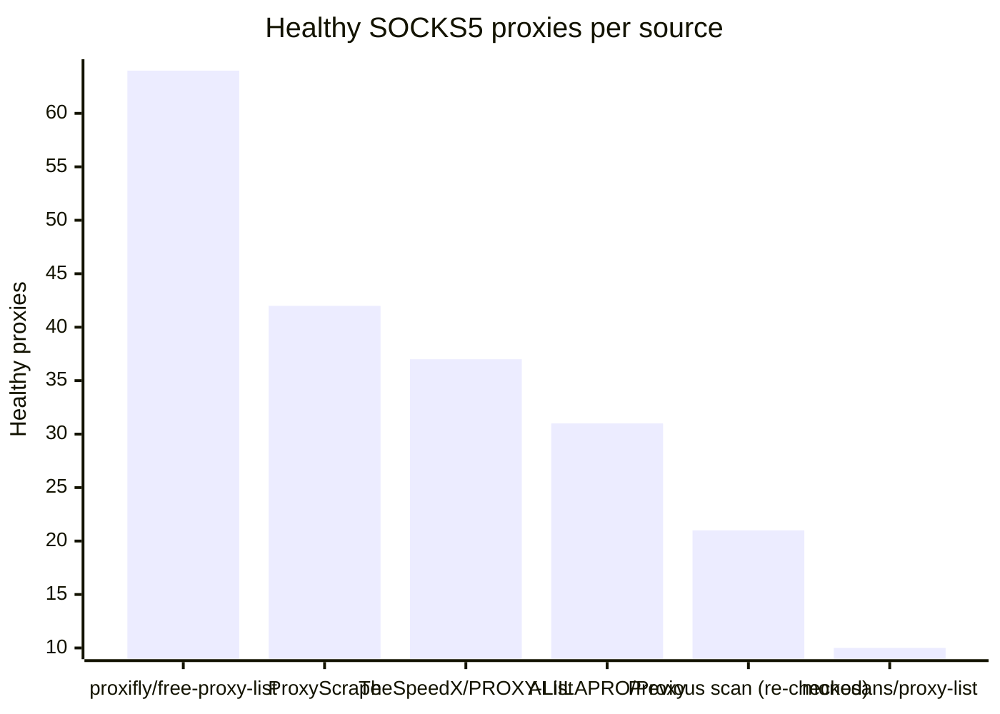

# Proxy Configs

<!-- dynamic timestamp placeholders for workflow sed script -->
channel_stats_chart.svg?v=1794765761
performance_report.html?v=1794765761

### Performance Chart

### Performance Report
[View Report](assets/performance_report.html?v=1794765761)

## HTTP

<!-- STATS:HTTP:START -->

_Last updated: 2026-11-15 12:13 UTC_

| Source | Healthy proxies |
|---|---|
| proxifly/free-proxy-list | 79 |
| TheSpeedX/PROXY-List | 45 |
| Previous scan (re-checked) | 41 |
| monosans/proxy-list | 25 |
| ProxyScrape | 20 |
| ALIILAPRO/Proxy | 16 |
| roosterkid/openproxylist | 1 |
| **Total unique** | **227** |

<!-- STATS:HTTP:END -->

## SOCKS5

<!-- STATS:SOCKS5:START -->

_Last updated: 2026-11-15 12:13 UTC_

| Source | Healthy proxies |
|---|---|
| proxifly/free-proxy-list | 64 |
| ProxyScrape | 42 |
| TheSpeedX/PROXY-List | 37 |
| ALIILAPRO/Proxy | 31 |
| Previous scan (re-checked) | 21 |
| monosans/proxy-list | 10 |
| **Total unique** | **205** |

<!-- STATS:SOCKS5:END -->
