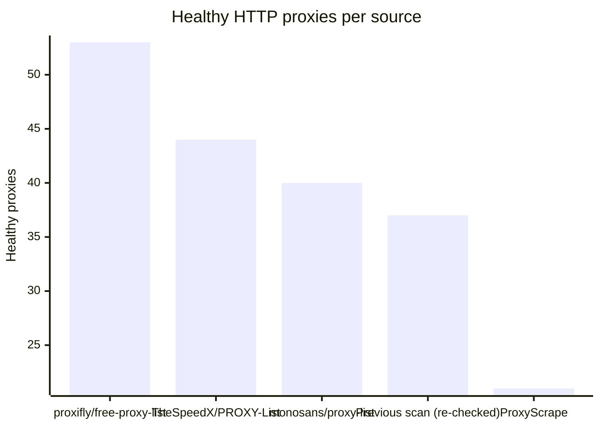
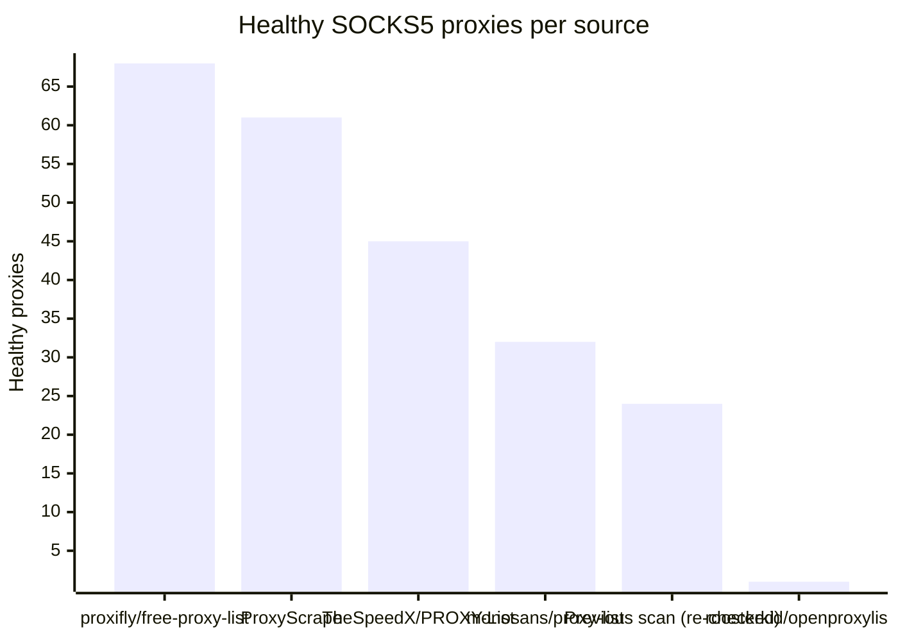

# Proxy Configs

<!-- dynamic timestamp placeholders for workflow sed script -->
channel_stats_chart.svg?v=1791309724
performance_report.html?v=1791309724

### Performance Chart

### Performance Report
[View Report](assets/performance_report.html?v=1791309724)

## HTTP

<!-- STATS:HTTP:START -->

_Last updated: 2026-11-01 06:13 UTC_

| Source | Healthy proxies |
|---|---|
| proxifly/free-proxy-list | 53 |
| TheSpeedX/PROXY-List | 44 |
| monosans/proxy-list | 40 |
| Previous scan (re-checked) | 37 |
| ProxyScrape | 21 |
| **Total unique** | **195** |

<!-- STATS:HTTP:END -->

## SOCKS5

<!-- STATS:SOCKS5:START -->

_Last updated: 2026-11-01 06:13 UTC_

| Source | Healthy proxies |
|---|---|
| proxifly/free-proxy-list | 68 |
| ProxyScrape | 61 |
| TheSpeedX/PROXY-List | 45 |
| monosans/proxy-list | 32 |
| Previous scan (re-checked) | 24 |
| roosterkid/openproxylist | 1 |
| **Total unique** | **231** |

<!-- STATS:SOCKS5:END -->
