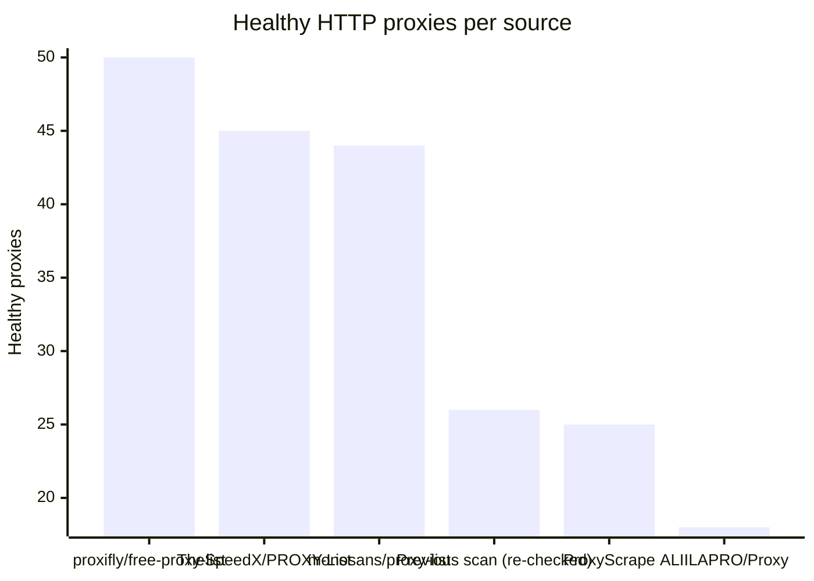
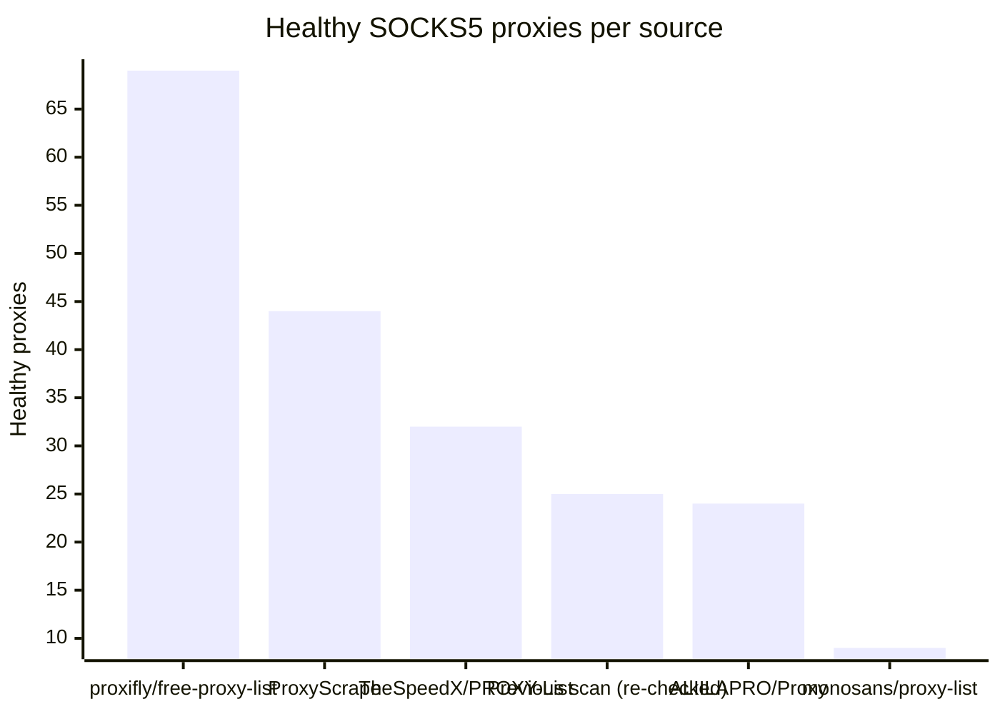

# Proxy Configs

<!-- dynamic timestamp placeholders for workflow sed script -->
channel_stats_chart.svg?v=1795284191
performance_report.html?v=1795284191

### Performance Chart

### Performance Report
[View Report](assets/performance_report.html?v=1795284191)

## HTTP

<!-- STATS:HTTP:START -->

_Last updated: 2026-11-21 12:15 UTC_

| Source | Healthy proxies |
|---|---|
| proxifly/free-proxy-list | 50 |
| TheSpeedX/PROXY-List | 45 |
| monosans/proxy-list | 44 |
| Previous scan (re-checked) | 26 |
| ProxyScrape | 25 |
| ALIILAPRO/Proxy | 18 |
| **Total unique** | **208** |

<!-- STATS:HTTP:END -->

## SOCKS5

<!-- STATS:SOCKS5:START -->

_Last updated: 2026-11-21 12:15 UTC_

| Source | Healthy proxies |
|---|---|
| proxifly/free-proxy-list | 69 |
| ProxyScrape | 44 |
| TheSpeedX/PROXY-List | 32 |
| Previous scan (re-checked) | 25 |
| ALIILAPRO/Proxy | 24 |
| monosans/proxy-list | 9 |
| **Total unique** | **203** |

<!-- STATS:SOCKS5:END -->
