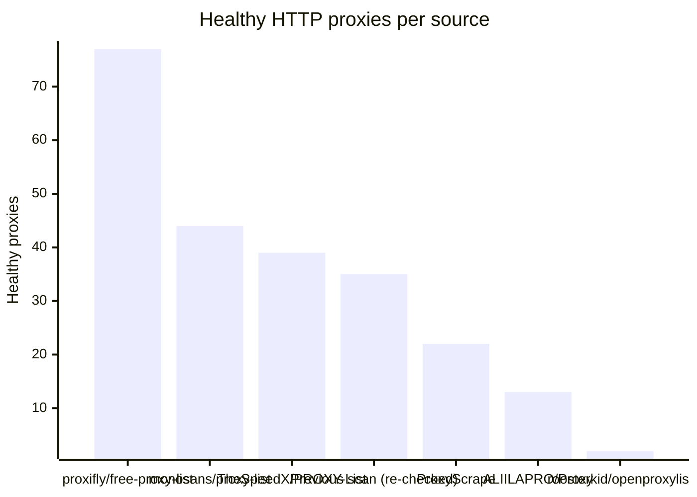
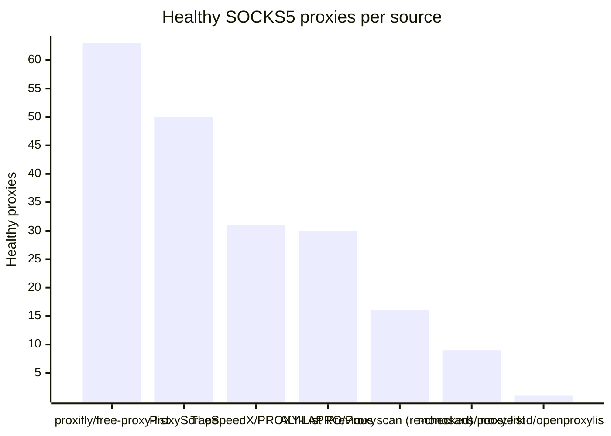

# Proxy Configs

<!-- dynamic timestamp placeholders for workflow sed script -->
channel_stats_chart.svg?v=1794528209
performance_report.html?v=1794528209

### Performance Chart

### Performance Report
[View Report](assets/performance_report.html?v=1794528209)

## HTTP

<!-- STATS:HTTP:START -->

_Last updated: 2026-11-12 18:15 UTC_

| Source | Healthy proxies |
|---|---|
| proxifly/free-proxy-list | 77 |
| monosans/proxy-list | 44 |
| TheSpeedX/PROXY-List | 39 |
| Previous scan (re-checked) | 35 |
| ProxyScrape | 22 |
| ALIILAPRO/Proxy | 13 |
| roosterkid/openproxylist | 2 |
| **Total unique** | **232** |

<!-- STATS:HTTP:END -->

## SOCKS5

<!-- STATS:SOCKS5:START -->

_Last updated: 2026-11-12 18:15 UTC_

| Source | Healthy proxies |
|---|---|
| proxifly/free-proxy-list | 63 |
| ProxyScrape | 50 |
| TheSpeedX/PROXY-List | 31 |
| ALIILAPRO/Proxy | 30 |
| Previous scan (re-checked) | 16 |
| monosans/proxy-list | 9 |
| roosterkid/openproxylist | 1 |
| **Total unique** | **200** |

<!-- STATS:SOCKS5:END -->
