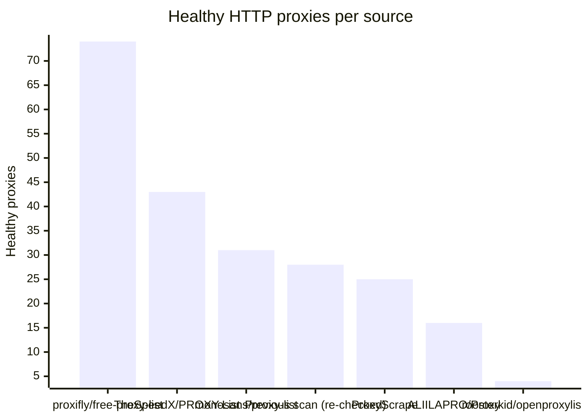
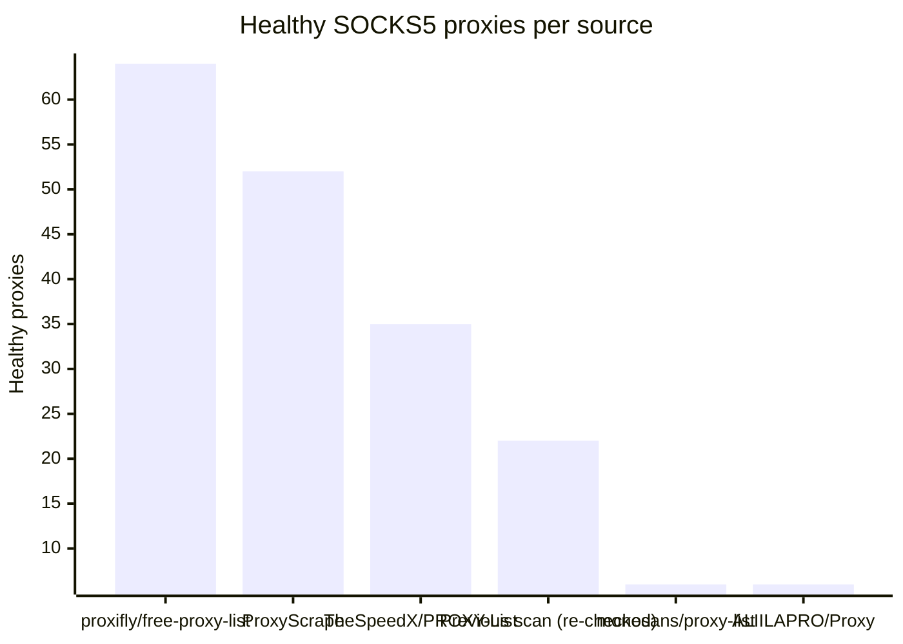

# Proxy Configs

<!-- dynamic timestamp placeholders for workflow sed script -->
channel_stats_chart.svg?v=1794873729
performance_report.html?v=1794873729

### Performance Chart

### Performance Report
[View Report](assets/performance_report.html?v=1794873729)

## HTTP

<!-- STATS:HTTP:START -->

_Last updated: 2026-11-16 18:15 UTC_

| Source | Healthy proxies |
|---|---|
| proxifly/free-proxy-list | 74 |
| TheSpeedX/PROXY-List | 43 |
| monosans/proxy-list | 31 |
| Previous scan (re-checked) | 28 |
| ProxyScrape | 25 |
| ALIILAPRO/Proxy | 16 |
| roosterkid/openproxylist | 4 |
| **Total unique** | **221** |

<!-- STATS:HTTP:END -->

## SOCKS5

<!-- STATS:SOCKS5:START -->

_Last updated: 2026-11-16 18:15 UTC_

| Source | Healthy proxies |
|---|---|
| proxifly/free-proxy-list | 64 |
| ProxyScrape | 52 |
| TheSpeedX/PROXY-List | 35 |
| Previous scan (re-checked) | 22 |
| monosans/proxy-list | 6 |
| ALIILAPRO/Proxy | 6 |
| **Total unique** | **185** |

<!-- STATS:SOCKS5:END -->
