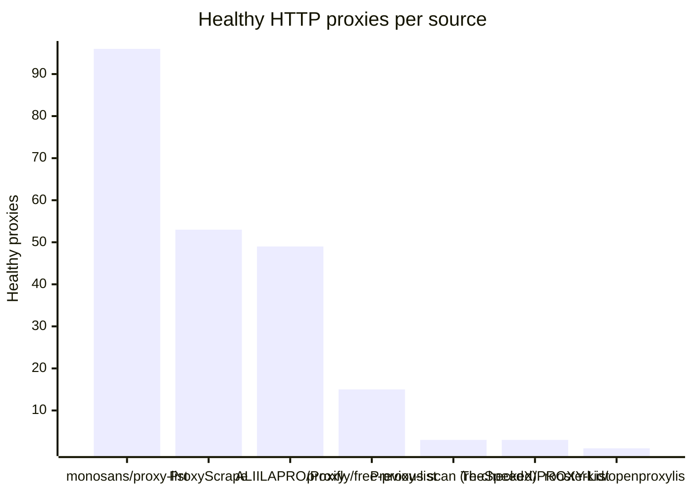
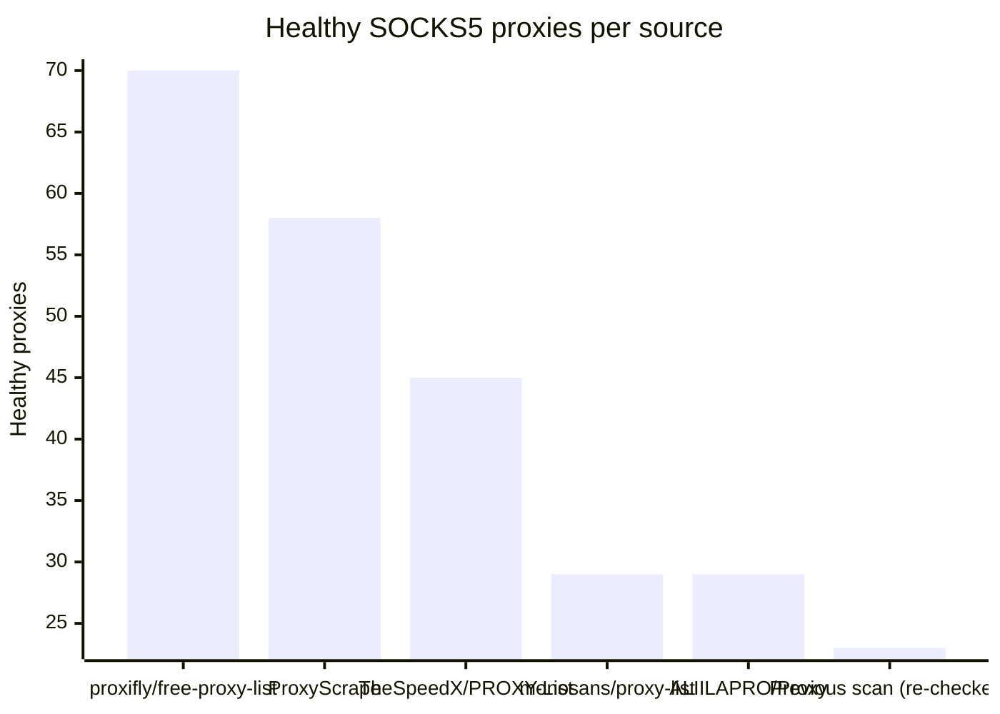

# Proxy Configs

<!-- dynamic timestamp placeholders for workflow sed script -->
channel_stats_chart.svg?v=1795003331
performance_report.html?v=1795003331

### Performance Chart

### Performance Report
[View Report](assets/performance_report.html?v=1795003331)

## HTTP

<!-- STATS:HTTP:START -->

_Last updated: 2026-11-18 06:13 UTC_

| Source | Healthy proxies |
|---|---|
| monosans/proxy-list | 96 |
| ProxyScrape | 53 |
| ALIILAPRO/Proxy | 49 |
| proxifly/free-proxy-list | 15 |
| Previous scan (re-checked) | 3 |
| TheSpeedX/PROXY-List | 3 |
| roosterkid/openproxylist | 1 |
| **Total unique** | **220** |

<!-- STATS:HTTP:END -->

## SOCKS5

<!-- STATS:SOCKS5:START -->

_Last updated: 2026-11-18 06:13 UTC_

| Source | Healthy proxies |
|---|---|
| proxifly/free-proxy-list | 70 |
| ProxyScrape | 58 |
| TheSpeedX/PROXY-List | 45 |
| monosans/proxy-list | 29 |
| ALIILAPRO/Proxy | 29 |
| Previous scan (re-checked) | 23 |
| **Total unique** | **254** |

<!-- STATS:SOCKS5:END -->
