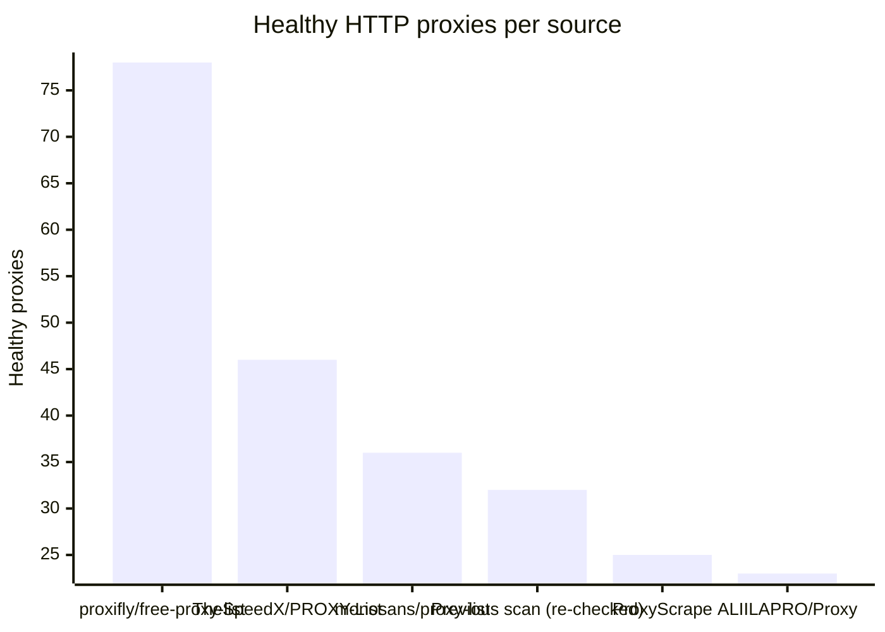
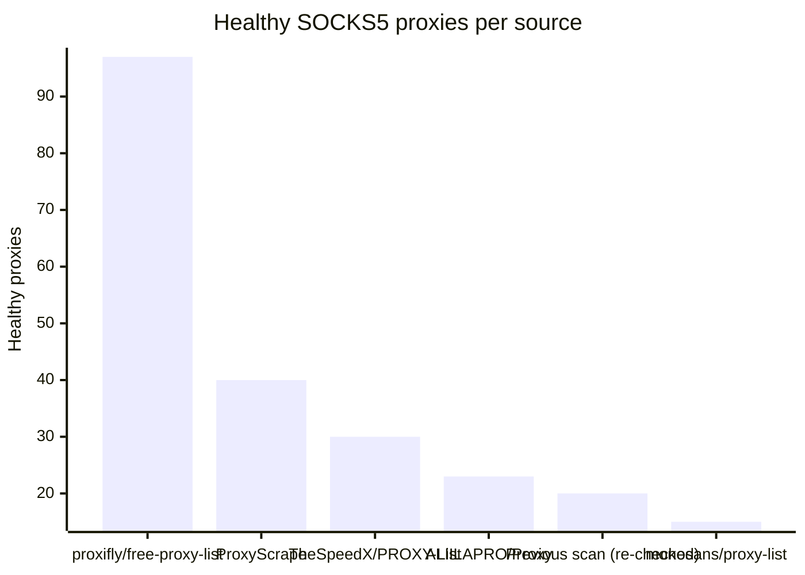

# Proxy Configs

<!-- dynamic timestamp placeholders for workflow sed script -->
channel_stats_chart.svg?v=1793275433
performance_report.html?v=1793275433

### Performance Chart

### Performance Report
[View Report](assets/performance_report.html?v=1793275433)

## HTTP

<!-- STATS:HTTP:START -->

_Last updated: 2026-10-29 06:22 UTC_

| Source | Healthy proxies |
|---|---|
| proxifly/free-proxy-list | 78 |
| TheSpeedX/PROXY-List | 46 |
| monosans/proxy-list | 36 |
| Previous scan (re-checked) | 32 |
| ProxyScrape | 25 |
| ALIILAPRO/Proxy | 23 |
| **Total unique** | **240** |

<!-- STATS:HTTP:END -->

## SOCKS5

<!-- STATS:SOCKS5:START -->

_Last updated: 2026-10-29 06:22 UTC_

| Source | Healthy proxies |
|---|---|
| proxifly/free-proxy-list | 97 |
| ProxyScrape | 40 |
| TheSpeedX/PROXY-List | 30 |
| ALIILAPRO/Proxy | 23 |
| Previous scan (re-checked) | 20 |
| monosans/proxy-list | 15 |
| **Total unique** | **225** |

<!-- STATS:SOCKS5:END -->
