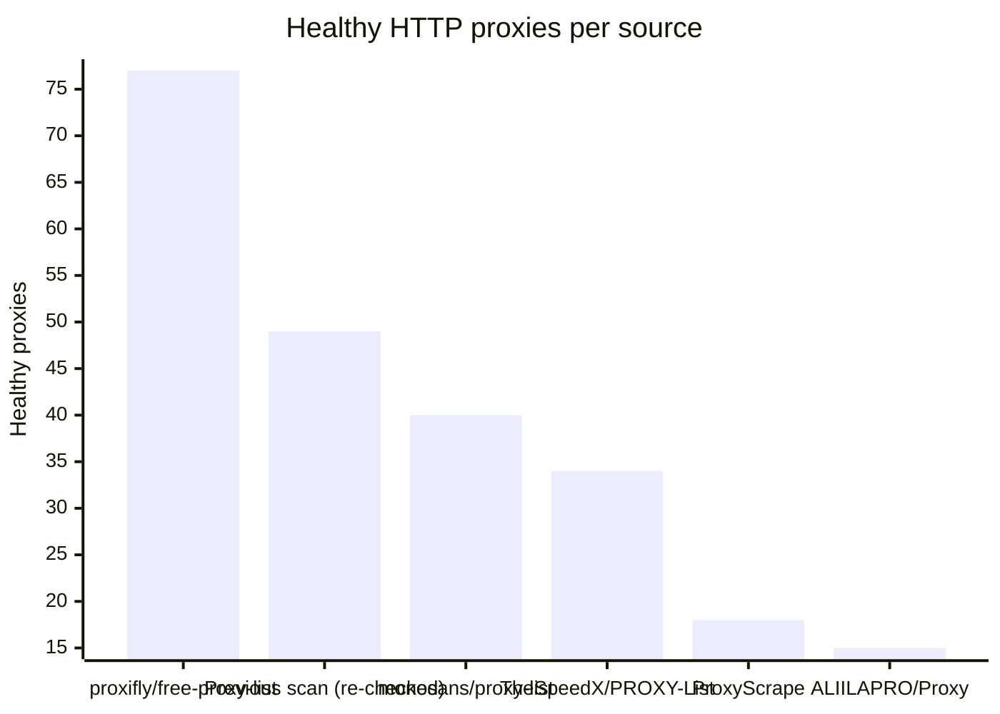

# Proxy Configs

<!-- dynamic timestamp placeholders for workflow sed script -->
channel_stats_chart.svg?v=1795672977
performance_report.html?v=1795672977

### Performance Chart

### Performance Report
[View Report](assets/performance_report.html?v=1795672977)

## HTTP

<!-- STATS:HTTP:START -->

_Last updated: 2026-11-26 00:13 UTC_

| Source | Healthy proxies |
|---|---|
| proxifly/free-proxy-list | 77 |
| Previous scan (re-checked) | 49 |
| monosans/proxy-list | 40 |
| TheSpeedX/PROXY-List | 34 |
| ProxyScrape | 18 |
| ALIILAPRO/Proxy | 15 |
| **Total unique** | **233** |

<!-- STATS:HTTP:END -->

## SOCKS5

<!-- STATS:SOCKS5:START -->

_Last updated: 2026-11-26 00:13 UTC_

| Source | Healthy proxies |
|---|---|
| proxifly/free-proxy-list | 82 |
| ProxyScrape | 53 |
| TheSpeedX/PROXY-List | 50 |
| Previous scan (re-checked) | 30 |
| monosans/proxy-list | 24 |
| ALIILAPRO/Proxy | 22 |
| **Total unique** | **261** |

<!-- STATS:SOCKS5:END -->
