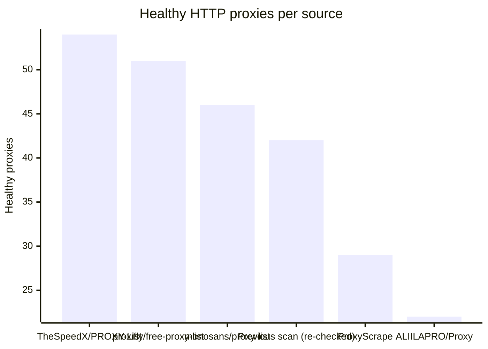
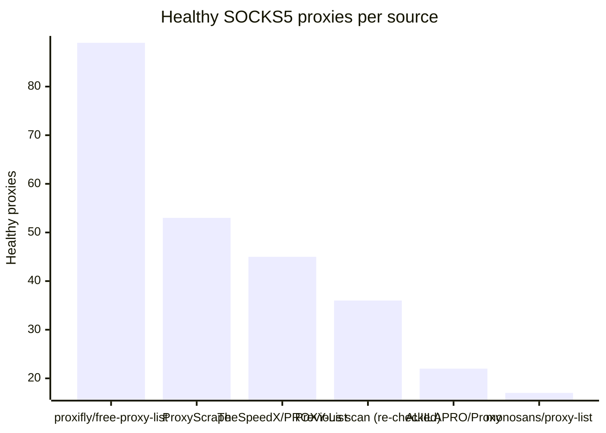

# Proxy Configs

<!-- dynamic timestamp placeholders for workflow sed script -->
channel_stats_chart.svg?v=1795521935
performance_report.html?v=1795521935

### Performance Chart

### Performance Report
[View Report](assets/performance_report.html?v=1795521935)

## HTTP

<!-- STATS:HTTP:START -->

_Last updated: 2026-11-24 06:15 UTC_

| Source | Healthy proxies |
|---|---|
| TheSpeedX/PROXY-List | 54 |
| proxifly/free-proxy-list | 51 |
| monosans/proxy-list | 46 |
| Previous scan (re-checked) | 42 |
| ProxyScrape | 29 |
| ALIILAPRO/Proxy | 22 |
| **Total unique** | **244** |

<!-- STATS:HTTP:END -->

## SOCKS5

<!-- STATS:SOCKS5:START -->

_Last updated: 2026-11-24 06:15 UTC_

| Source | Healthy proxies |
|---|---|
| proxifly/free-proxy-list | 89 |
| ProxyScrape | 53 |
| TheSpeedX/PROXY-List | 45 |
| Previous scan (re-checked) | 36 |
| ALIILAPRO/Proxy | 22 |
| monosans/proxy-list | 17 |
| **Total unique** | **262** |

<!-- STATS:SOCKS5:END -->
