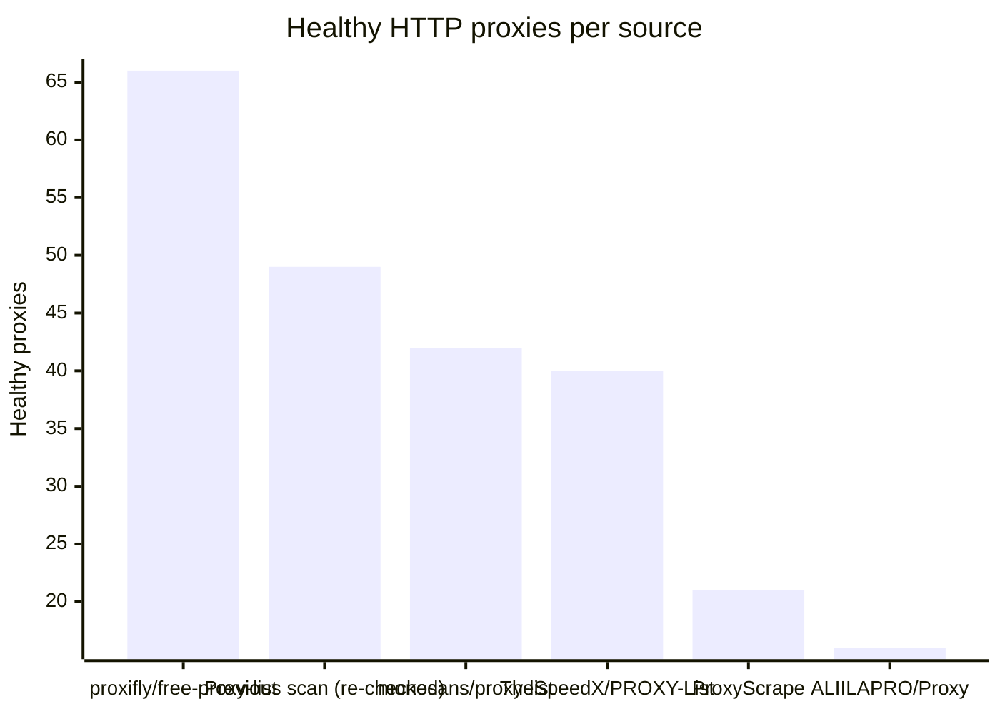

# Proxy Configs

<!-- dynamic timestamp placeholders for workflow sed script -->
channel_stats_chart.svg?v=1795608138
performance_report.html?v=1795608138

### Performance Chart

### Performance Report
[View Report](assets/performance_report.html?v=1795608138)

## HTTP

<!-- STATS:HTTP:START -->

_Last updated: 2026-11-25 06:13 UTC_

| Source | Healthy proxies |
|---|---|
| proxifly/free-proxy-list | 66 |
| Previous scan (re-checked) | 49 |
| monosans/proxy-list | 42 |
| TheSpeedX/PROXY-List | 40 |
| ProxyScrape | 21 |
| ALIILAPRO/Proxy | 16 |
| **Total unique** | **234** |

<!-- STATS:HTTP:END -->

## SOCKS5

<!-- STATS:SOCKS5:START -->

_Last updated: 2026-11-25 06:13 UTC_

| Source | Healthy proxies |
|---|---|
| proxifly/free-proxy-list | 84 |
| ProxyScrape | 49 |
| TheSpeedX/PROXY-List | 41 |
| Previous scan (re-checked) | 31 |
| monosans/proxy-list | 17 |
| ALIILAPRO/Proxy | 12 |
| roosterkid/openproxylist | 2 |
| **Total unique** | **236** |

<!-- STATS:SOCKS5:END -->
