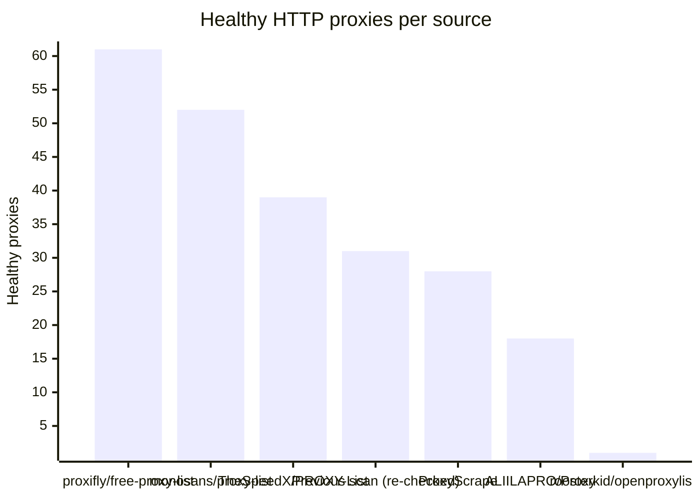
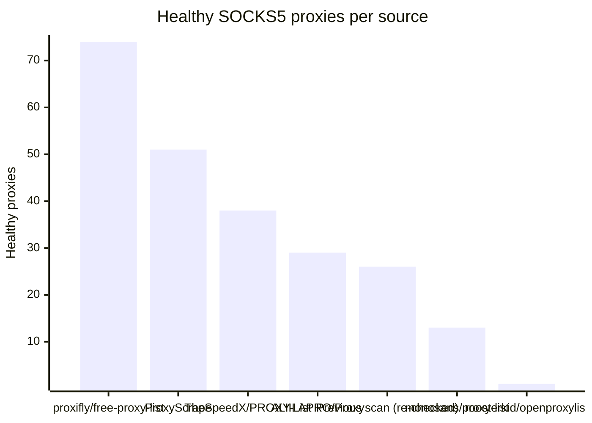

# Proxy Configs

<!-- dynamic timestamp placeholders for workflow sed script -->
channel_stats_chart.svg?v=1795327406
performance_report.html?v=1795327406

### Performance Chart

### Performance Report
[View Report](assets/performance_report.html?v=1795327406)

## HTTP

<!-- STATS:HTTP:START -->

_Last updated: 2026-11-22 00:14 UTC_

| Source | Healthy proxies |
|---|---|
| proxifly/free-proxy-list | 61 |
| monosans/proxy-list | 52 |
| TheSpeedX/PROXY-List | 39 |
| Previous scan (re-checked) | 31 |
| ProxyScrape | 28 |
| ALIILAPRO/Proxy | 18 |
| roosterkid/openproxylist | 1 |
| **Total unique** | **230** |

<!-- STATS:HTTP:END -->

## SOCKS5

<!-- STATS:SOCKS5:START -->

_Last updated: 2026-11-22 00:14 UTC_

| Source | Healthy proxies |
|---|---|
| proxifly/free-proxy-list | 74 |
| ProxyScrape | 51 |
| TheSpeedX/PROXY-List | 38 |
| ALIILAPRO/Proxy | 29 |
| Previous scan (re-checked) | 26 |
| monosans/proxy-list | 13 |
| roosterkid/openproxylist | 1 |
| **Total unique** | **232** |

<!-- STATS:SOCKS5:END -->
