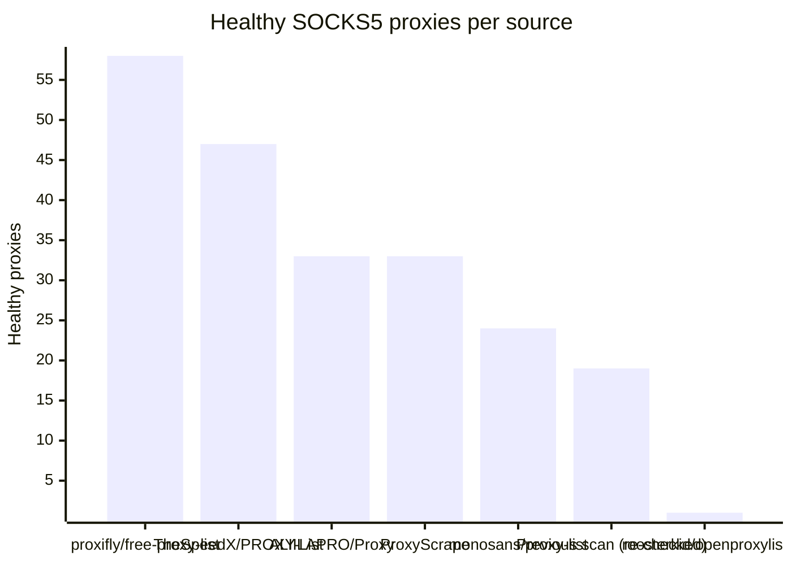

# Proxy Configs

<!-- dynamic timestamp placeholders for workflow sed script -->
channel_stats_chart.svg?v=1793599347
performance_report.html?v=1793599347

### Performance Chart

### Performance Report
[View Report](assets/performance_report.html?v=1793599347)

## HTTP

<!-- STATS:HTTP:START -->

_Last updated: 2026-11-02 00:18 UTC_

| Source | Healthy proxies |
|---|---|
| monosans/proxy-list | 65 |
| proxifly/free-proxy-list | 45 |
| Previous scan (re-checked) | 33 |
| TheSpeedX/PROXY-List | 30 |
| ProxyScrape | 18 |
| ALIILAPRO/Proxy | 16 |
| **Total unique** | **207** |

<!-- STATS:HTTP:END -->

## SOCKS5

<!-- STATS:SOCKS5:START -->

_Last updated: 2026-11-02 00:18 UTC_

| Source | Healthy proxies |
|---|---|
| proxifly/free-proxy-list | 58 |
| TheSpeedX/PROXY-List | 47 |
| ALIILAPRO/Proxy | 33 |
| ProxyScrape | 33 |
| monosans/proxy-list | 24 |
| Previous scan (re-checked) | 19 |
| roosterkid/openproxylist | 1 |
| **Total unique** | **215** |

<!-- STATS:SOCKS5:END -->
