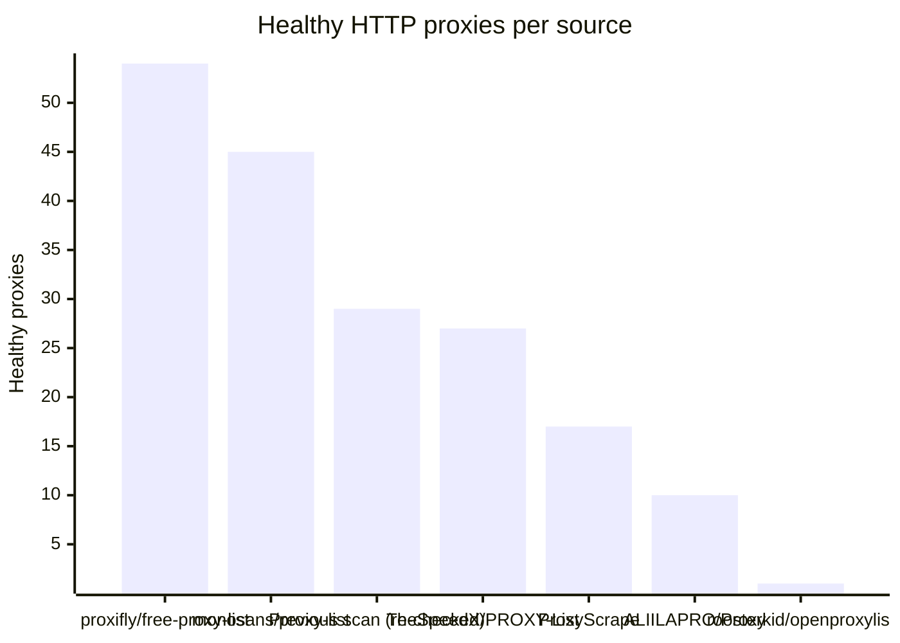
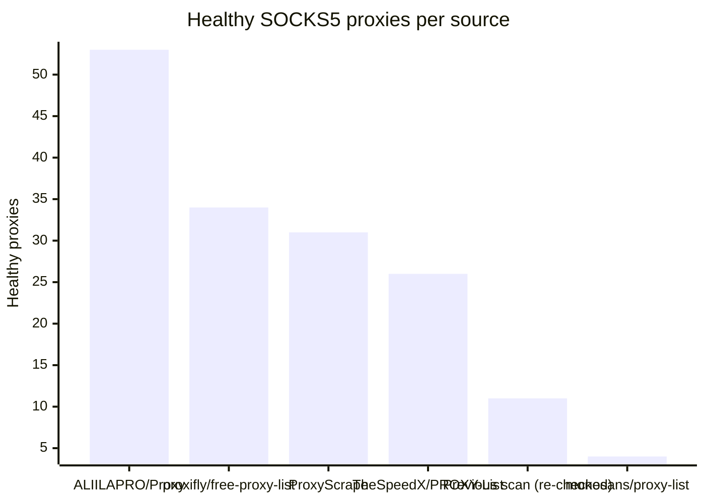

# Proxy Configs

<!-- dynamic timestamp placeholders for workflow sed script -->
channel_stats_chart.svg?v=1794009885
performance_report.html?v=1794009885

### Performance Chart

### Performance Report
[View Report](assets/performance_report.html?v=1794009885)

## HTTP

<!-- STATS:HTTP:START -->

_Last updated: 2026-11-06 18:17 UTC_

| Source | Healthy proxies |
|---|---|
| proxifly/free-proxy-list | 54 |
| monosans/proxy-list | 45 |
| Previous scan (re-checked) | 29 |
| TheSpeedX/PROXY-List | 27 |
| ProxyScrape | 17 |
| ALIILAPRO/Proxy | 10 |
| roosterkid/openproxylist | 1 |
| **Total unique** | **183** |

<!-- STATS:HTTP:END -->

## SOCKS5

<!-- STATS:SOCKS5:START -->

_Last updated: 2026-11-06 18:17 UTC_

| Source | Healthy proxies |
|---|---|
| ALIILAPRO/Proxy | 53 |
| proxifly/free-proxy-list | 34 |
| ProxyScrape | 31 |
| TheSpeedX/PROXY-List | 26 |
| Previous scan (re-checked) | 11 |
| monosans/proxy-list | 4 |
| **Total unique** | **159** |

<!-- STATS:SOCKS5:END -->
