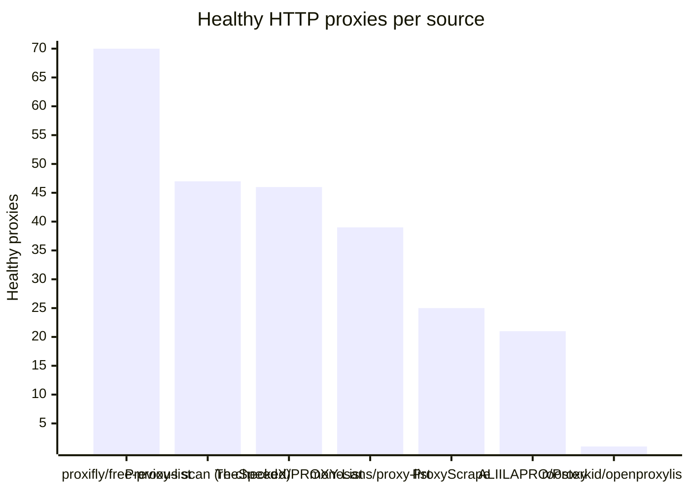
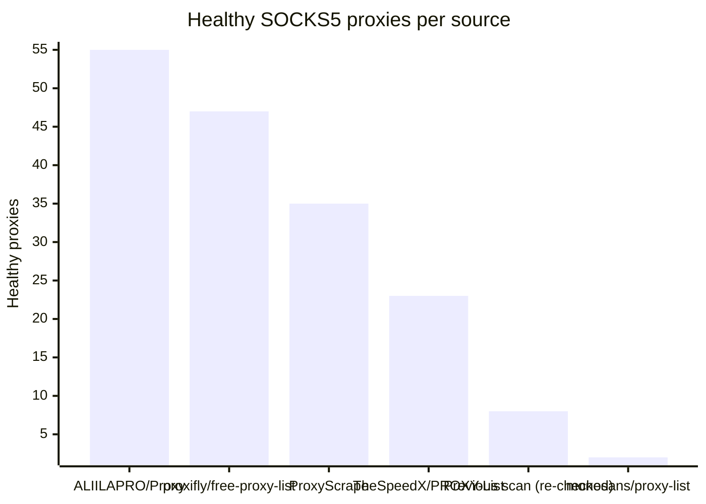

# Proxy Configs

<!-- dynamic timestamp placeholders for workflow sed script -->
channel_stats_chart.svg?v=1794268935
performance_report.html?v=1794268935

### Performance Chart

### Performance Report
[View Report](assets/performance_report.html?v=1794268935)

## HTTP

<!-- STATS:HTTP:START -->

_Last updated: 2026-11-09 18:15 UTC_

| Source | Healthy proxies |
|---|---|
| proxifly/free-proxy-list | 70 |
| Previous scan (re-checked) | 47 |
| TheSpeedX/PROXY-List | 46 |
| monosans/proxy-list | 39 |
| ProxyScrape | 25 |
| ALIILAPRO/Proxy | 21 |
| roosterkid/openproxylist | 1 |
| **Total unique** | **249** |

<!-- STATS:HTTP:END -->

## SOCKS5

<!-- STATS:SOCKS5:START -->

_Last updated: 2026-11-09 18:15 UTC_

| Source | Healthy proxies |
|---|---|
| ALIILAPRO/Proxy | 55 |
| proxifly/free-proxy-list | 47 |
| ProxyScrape | 35 |
| TheSpeedX/PROXY-List | 23 |
| Previous scan (re-checked) | 8 |
| monosans/proxy-list | 2 |
| **Total unique** | **170** |

<!-- STATS:SOCKS5:END -->
