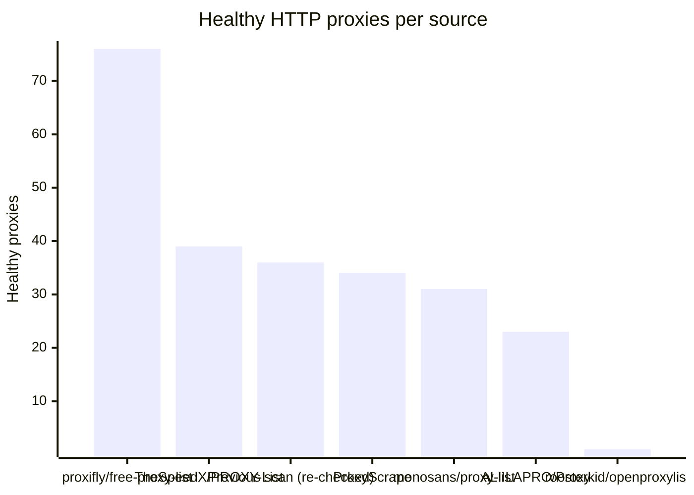
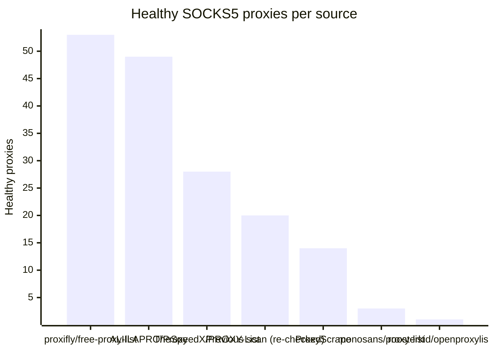

# Proxy Configs

<!-- dynamic timestamp placeholders for workflow sed script -->
channel_stats_chart.svg?v=1794592986
performance_report.html?v=1794592986

### Performance Chart

### Performance Report
[View Report](assets/performance_report.html?v=1794592986)

## HTTP

<!-- STATS:HTTP:START -->

_Last updated: 2026-11-13 12:13 UTC_

| Source | Healthy proxies |
|---|---|
| proxifly/free-proxy-list | 76 |
| TheSpeedX/PROXY-List | 39 |
| Previous scan (re-checked) | 36 |
| ProxyScrape | 34 |
| monosans/proxy-list | 31 |
| ALIILAPRO/Proxy | 23 |
| roosterkid/openproxylist | 1 |
| **Total unique** | **240** |

<!-- STATS:HTTP:END -->

## SOCKS5

<!-- STATS:SOCKS5:START -->

_Last updated: 2026-11-13 12:13 UTC_

| Source | Healthy proxies |
|---|---|
| proxifly/free-proxy-list | 53 |
| ALIILAPRO/Proxy | 49 |
| TheSpeedX/PROXY-List | 28 |
| Previous scan (re-checked) | 20 |
| ProxyScrape | 14 |
| monosans/proxy-list | 3 |
| roosterkid/openproxylist | 1 |
| **Total unique** | **168** |

<!-- STATS:SOCKS5:END -->
