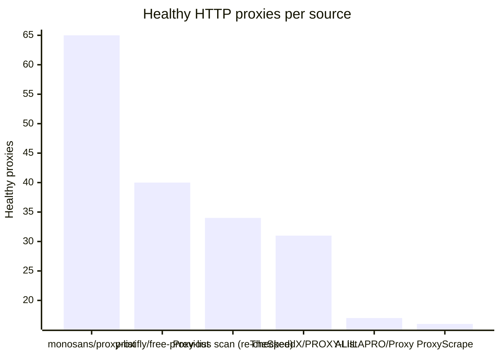
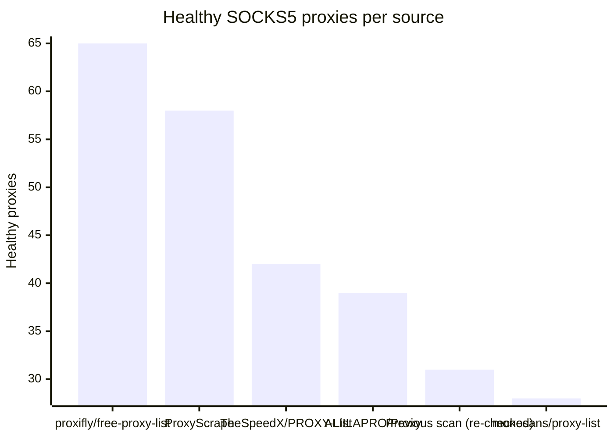

# Proxy Configs

<!-- dynamic timestamp placeholders for workflow sed script -->
channel_stats_chart.svg?v=1793707362
performance_report.html?v=1793707362

### Performance Chart

### Performance Report
[View Report](assets/performance_report.html?v=1793707362)

## HTTP

<!-- STATS:HTTP:START -->

_Last updated: 2026-11-03 06:15 UTC_

| Source | Healthy proxies |
|---|---|
| monosans/proxy-list | 65 |
| proxifly/free-proxy-list | 40 |
| Previous scan (re-checked) | 34 |
| TheSpeedX/PROXY-List | 31 |
| ALIILAPRO/Proxy | 17 |
| ProxyScrape | 16 |
| **Total unique** | **203** |

<!-- STATS:HTTP:END -->

## SOCKS5

<!-- STATS:SOCKS5:START -->

_Last updated: 2026-11-03 06:15 UTC_

| Source | Healthy proxies |
|---|---|
| proxifly/free-proxy-list | 65 |
| ProxyScrape | 58 |
| TheSpeedX/PROXY-List | 42 |
| ALIILAPRO/Proxy | 39 |
| Previous scan (re-checked) | 31 |
| monosans/proxy-list | 28 |
| **Total unique** | **263** |

<!-- STATS:SOCKS5:END -->
