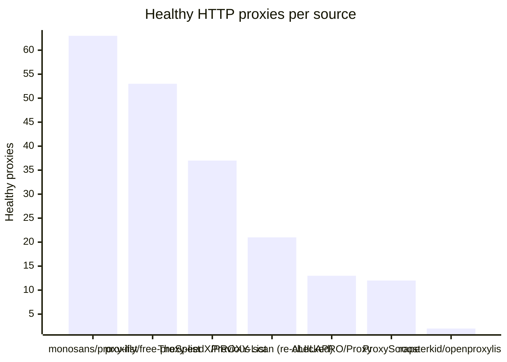
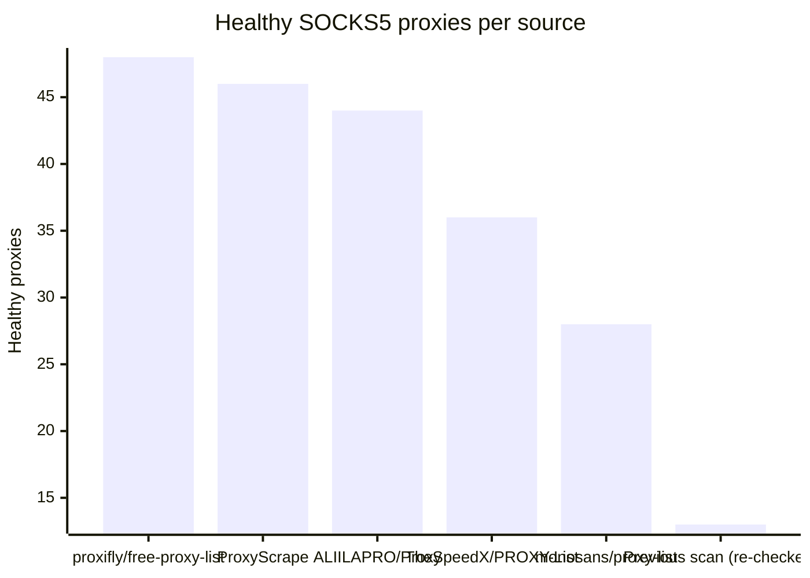

# Proxy Configs

<!-- dynamic timestamp placeholders for workflow sed script -->
channel_stats_chart.svg?v=1793988147
performance_report.html?v=1793988147

### Performance Chart

### Performance Report
[View Report](assets/performance_report.html?v=1793988147)

## HTTP

<!-- STATS:HTTP:START -->

_Last updated: 2026-11-06 12:17 UTC_

| Source | Healthy proxies |
|---|---|
| monosans/proxy-list | 63 |
| proxifly/free-proxy-list | 53 |
| TheSpeedX/PROXY-List | 37 |
| Previous scan (re-checked) | 21 |
| ALIILAPRO/Proxy | 13 |
| ProxyScrape | 12 |
| roosterkid/openproxylist | 2 |
| **Total unique** | **201** |

<!-- STATS:HTTP:END -->

## SOCKS5

<!-- STATS:SOCKS5:START -->

_Last updated: 2026-11-06 12:17 UTC_

| Source | Healthy proxies |
|---|---|
| proxifly/free-proxy-list | 48 |
| ProxyScrape | 46 |
| ALIILAPRO/Proxy | 44 |
| TheSpeedX/PROXY-List | 36 |
| monosans/proxy-list | 28 |
| Previous scan (re-checked) | 13 |
| **Total unique** | **215** |

<!-- STATS:SOCKS5:END -->
