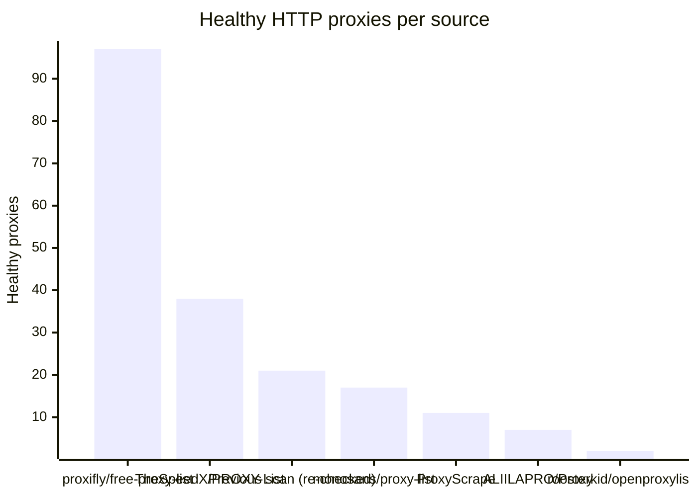
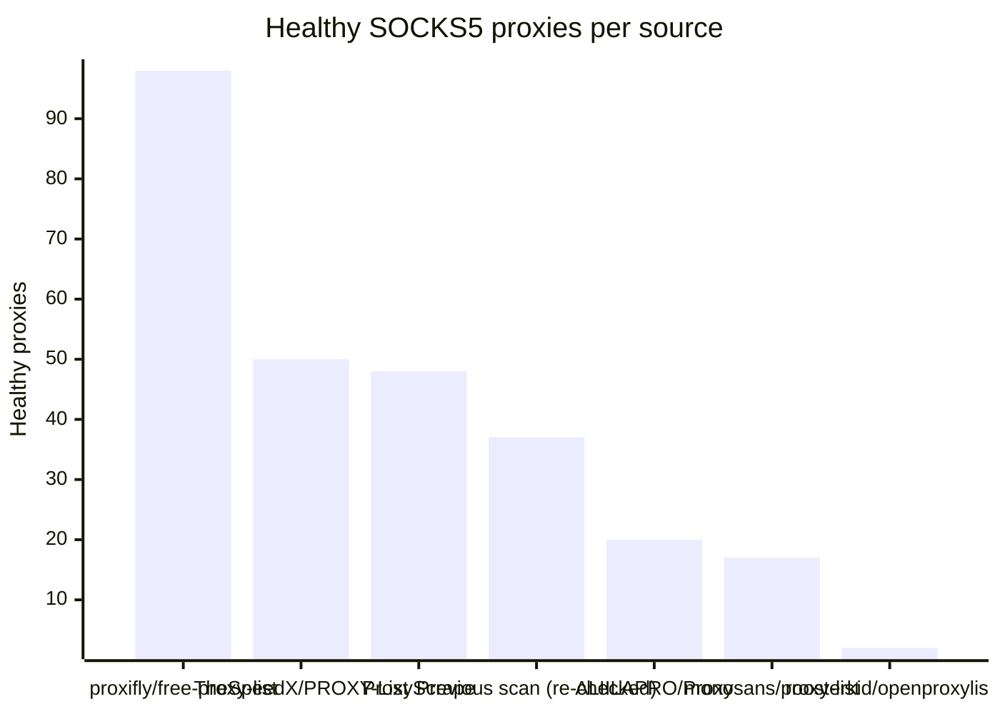

# Proxy Configs

<!-- dynamic timestamp placeholders for workflow sed script -->
channel_stats_chart.svg?v=1793016226
performance_report.html?v=1793016226

### Performance Chart

### Performance Report
[View Report](assets/performance_report.html?v=1793016226)

## HTTP

<!-- STATS:HTTP:START -->

_Last updated: 2026-10-26 06:22 UTC_

| Source | Healthy proxies |
|---|---|
| proxifly/free-proxy-list | 97 |
| TheSpeedX/PROXY-List | 38 |
| Previous scan (re-checked) | 21 |
| monosans/proxy-list | 17 |
| ProxyScrape | 11 |
| ALIILAPRO/Proxy | 7 |
| roosterkid/openproxylist | 2 |
| **Total unique** | **193** |

<!-- STATS:HTTP:END -->

## SOCKS5

<!-- STATS:SOCKS5:START -->

_Last updated: 2026-10-26 06:22 UTC_

| Source | Healthy proxies |
|---|---|
| proxifly/free-proxy-list | 98 |
| TheSpeedX/PROXY-List | 50 |
| ProxyScrape | 48 |
| Previous scan (re-checked) | 37 |
| ALIILAPRO/Proxy | 20 |
| monosans/proxy-list | 17 |
| roosterkid/openproxylist | 2 |
| **Total unique** | **272** |

<!-- STATS:SOCKS5:END -->
