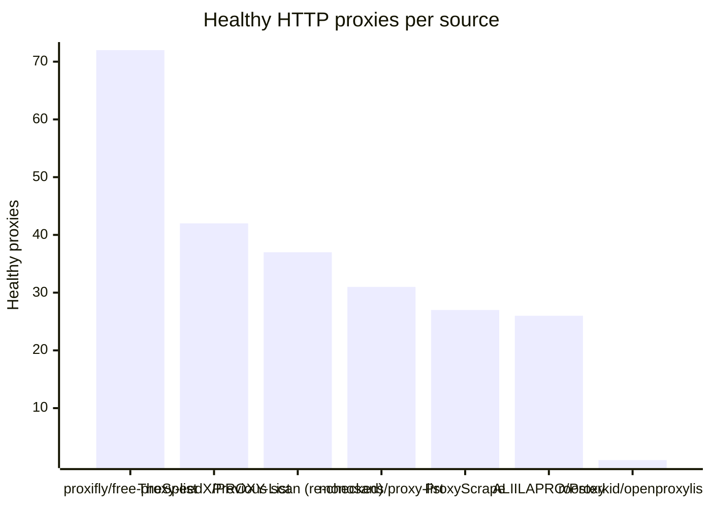
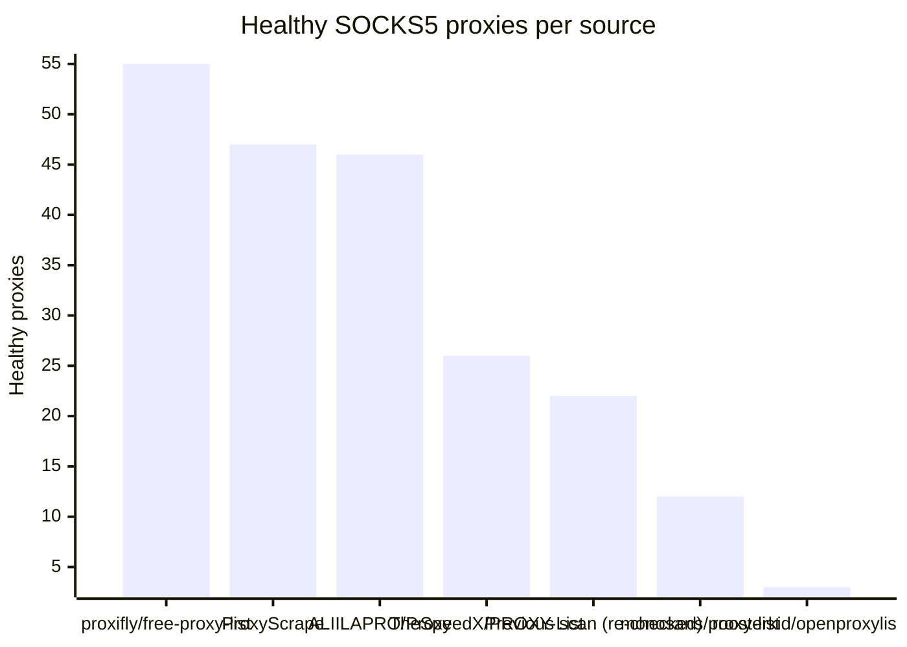

# Proxy Configs

<!-- dynamic timestamp placeholders for workflow sed script -->
channel_stats_chart.svg?v=1793426675
performance_report.html?v=1793426675

### Performance Chart

### Performance Report
[View Report](assets/performance_report.html?v=1793426675)

## HTTP

<!-- STATS:HTTP:START -->

_Last updated: 2026-10-31 00:15 UTC_

| Source | Healthy proxies |
|---|---|
| proxifly/free-proxy-list | 72 |
| TheSpeedX/PROXY-List | 42 |
| Previous scan (re-checked) | 37 |
| monosans/proxy-list | 31 |
| ProxyScrape | 27 |
| ALIILAPRO/Proxy | 26 |
| roosterkid/openproxylist | 1 |
| **Total unique** | **236** |

<!-- STATS:HTTP:END -->

## SOCKS5

<!-- STATS:SOCKS5:START -->

_Last updated: 2026-10-31 00:15 UTC_

| Source | Healthy proxies |
|---|---|
| proxifly/free-proxy-list | 55 |
| ProxyScrape | 47 |
| ALIILAPRO/Proxy | 46 |
| TheSpeedX/PROXY-List | 26 |
| Previous scan (re-checked) | 22 |
| monosans/proxy-list | 12 |
| roosterkid/openproxylist | 3 |
| **Total unique** | **211** |

<!-- STATS:SOCKS5:END -->
