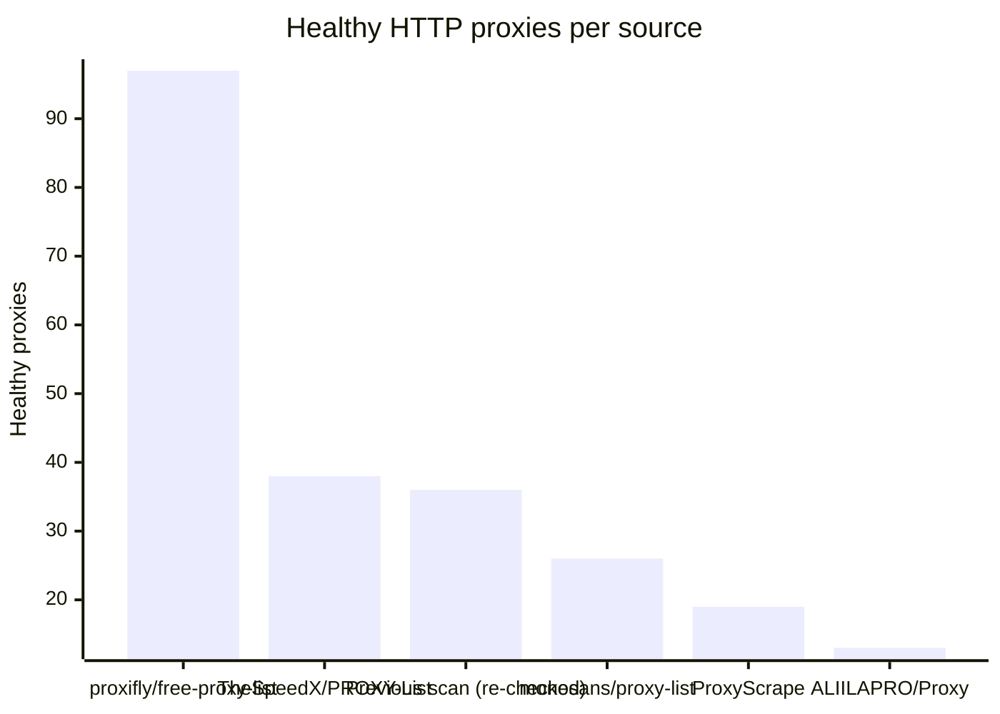
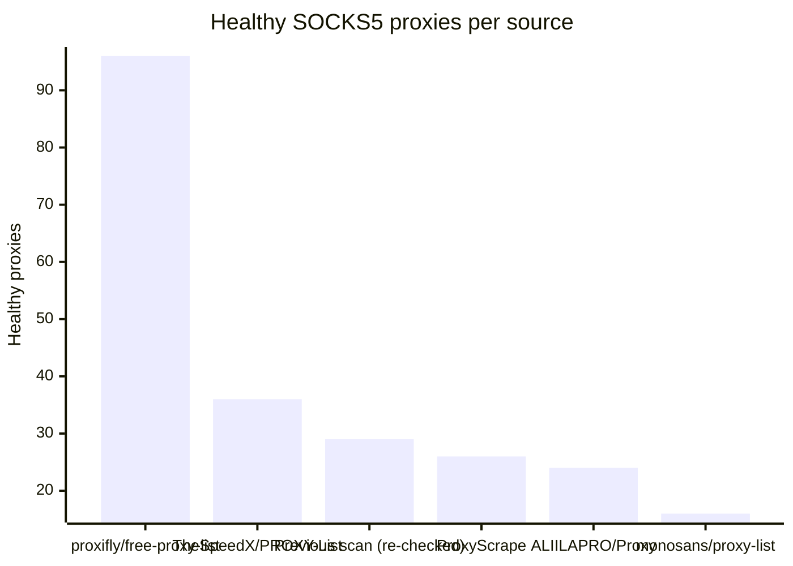

# Proxy Configs

<!-- dynamic timestamp placeholders for workflow sed script -->
channel_stats_chart.svg?v=1792994624
performance_report.html?v=1792994624

### Performance Chart

### Performance Report
[View Report](assets/performance_report.html?v=1792994624)

## HTTP

<!-- STATS:HTTP:START -->

_Last updated: 2026-10-26 00:21 UTC_

| Source | Healthy proxies |
|---|---|
| proxifly/free-proxy-list | 97 |
| TheSpeedX/PROXY-List | 38 |
| Previous scan (re-checked) | 36 |
| monosans/proxy-list | 26 |
| ProxyScrape | 19 |
| ALIILAPRO/Proxy | 13 |
| **Total unique** | **229** |

<!-- STATS:HTTP:END -->

## SOCKS5

<!-- STATS:SOCKS5:START -->

_Last updated: 2026-10-26 00:21 UTC_

| Source | Healthy proxies |
|---|---|
| proxifly/free-proxy-list | 96 |
| TheSpeedX/PROXY-List | 36 |
| Previous scan (re-checked) | 29 |
| ProxyScrape | 26 |
| ALIILAPRO/Proxy | 24 |
| monosans/proxy-list | 16 |
| **Total unique** | **227** |

<!-- STATS:SOCKS5:END -->
