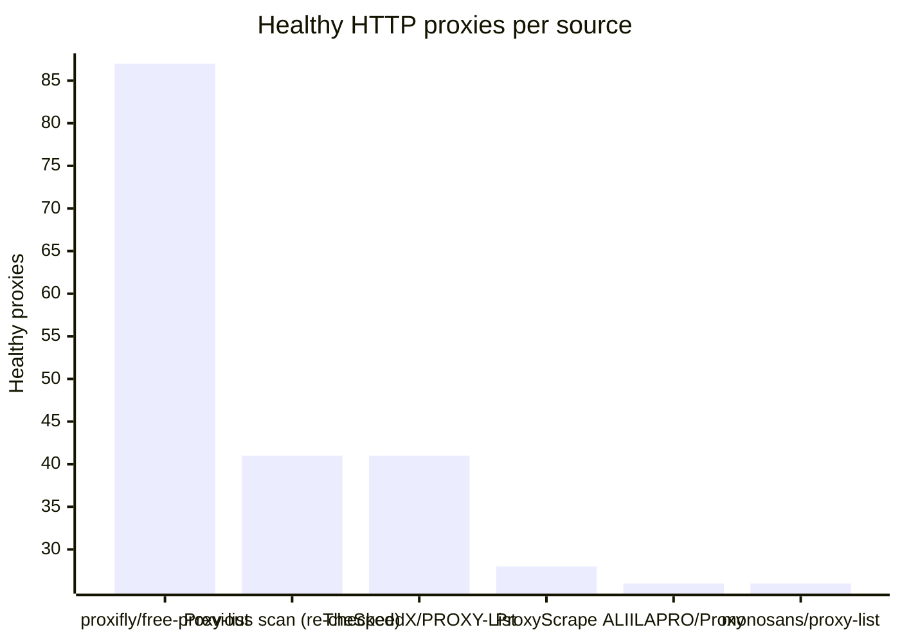
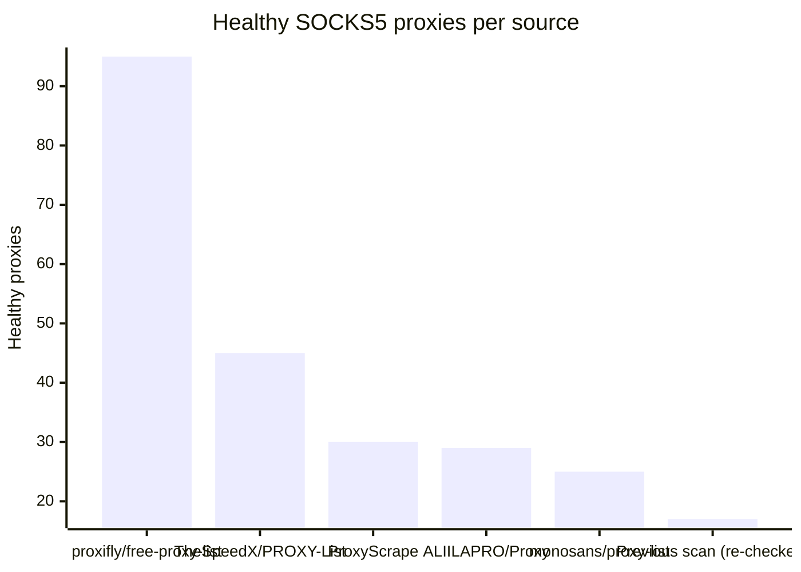

# Proxy Configs

<!-- dynamic timestamp placeholders for workflow sed script -->
channel_stats_chart.svg?v=1793167528
performance_report.html?v=1793167528

### Performance Chart

### Performance Report
[View Report](assets/performance_report.html?v=1793167528)

## HTTP

<!-- STATS:HTTP:START -->

_Last updated: 2026-10-28 00:25 UTC_

| Source | Healthy proxies |
|---|---|
| proxifly/free-proxy-list | 87 |
| Previous scan (re-checked) | 41 |
| TheSpeedX/PROXY-List | 41 |
| ProxyScrape | 28 |
| ALIILAPRO/Proxy | 26 |
| monosans/proxy-list | 26 |
| **Total unique** | **249** |

<!-- STATS:HTTP:END -->

## SOCKS5

<!-- STATS:SOCKS5:START -->

_Last updated: 2026-10-28 00:25 UTC_

| Source | Healthy proxies |
|---|---|
| proxifly/free-proxy-list | 95 |
| TheSpeedX/PROXY-List | 45 |
| ProxyScrape | 30 |
| ALIILAPRO/Proxy | 29 |
| monosans/proxy-list | 25 |
| Previous scan (re-checked) | 17 |
| **Total unique** | **241** |

<!-- STATS:SOCKS5:END -->
