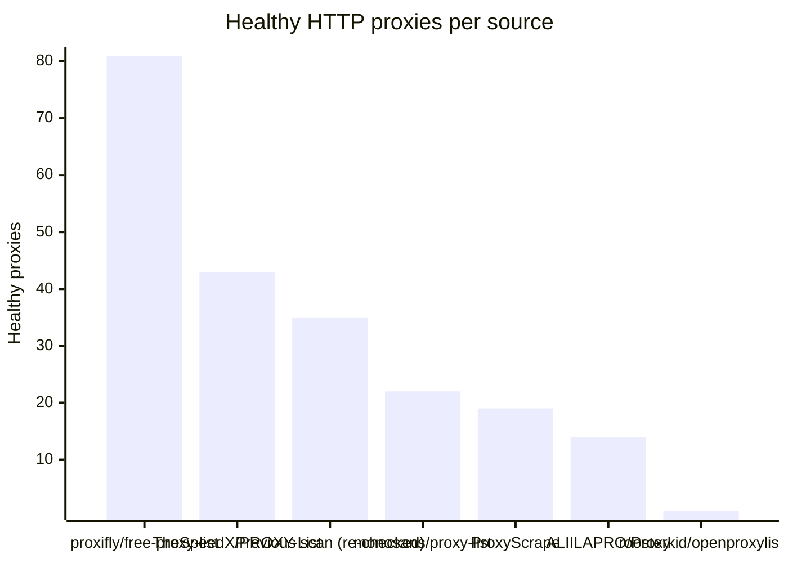
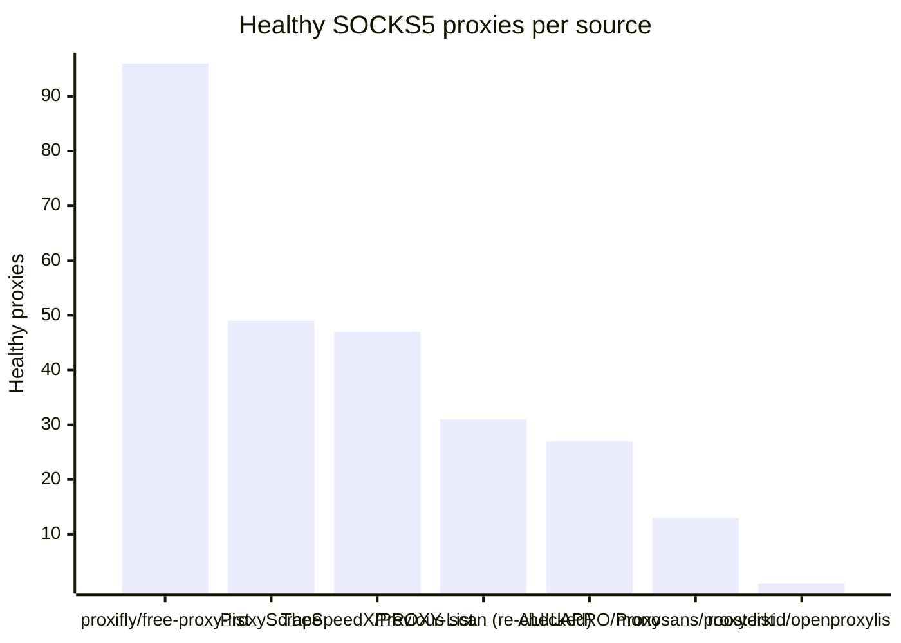

# Proxy Configs

<!-- dynamic timestamp placeholders for workflow sed script -->
channel_stats_chart.svg?v=1791849801
performance_report.html?v=1791849801

### Performance Chart

### Performance Report
[View Report](assets/performance_report.html?v=1791849801)

## HTTP

<!-- STATS:HTTP:START -->

_Last updated: 2026-10-12 18:23 UTC_

| Source | Healthy proxies |
|---|---|
| proxifly/free-proxy-list | 81 |
| TheSpeedX/PROXY-List | 43 |
| Previous scan (re-checked) | 35 |
| monosans/proxy-list | 22 |
| ProxyScrape | 19 |
| ALIILAPRO/Proxy | 14 |
| roosterkid/openproxylist | 1 |
| **Total unique** | **215** |

<!-- STATS:HTTP:END -->

## SOCKS5

<!-- STATS:SOCKS5:START -->

_Last updated: 2026-10-12 18:23 UTC_

| Source | Healthy proxies |
|---|---|
| proxifly/free-proxy-list | 96 |
| ProxyScrape | 49 |
| TheSpeedX/PROXY-List | 47 |
| Previous scan (re-checked) | 31 |
| ALIILAPRO/Proxy | 27 |
| monosans/proxy-list | 13 |
| roosterkid/openproxylist | 1 |
| **Total unique** | **264** |

<!-- STATS:SOCKS5:END -->
