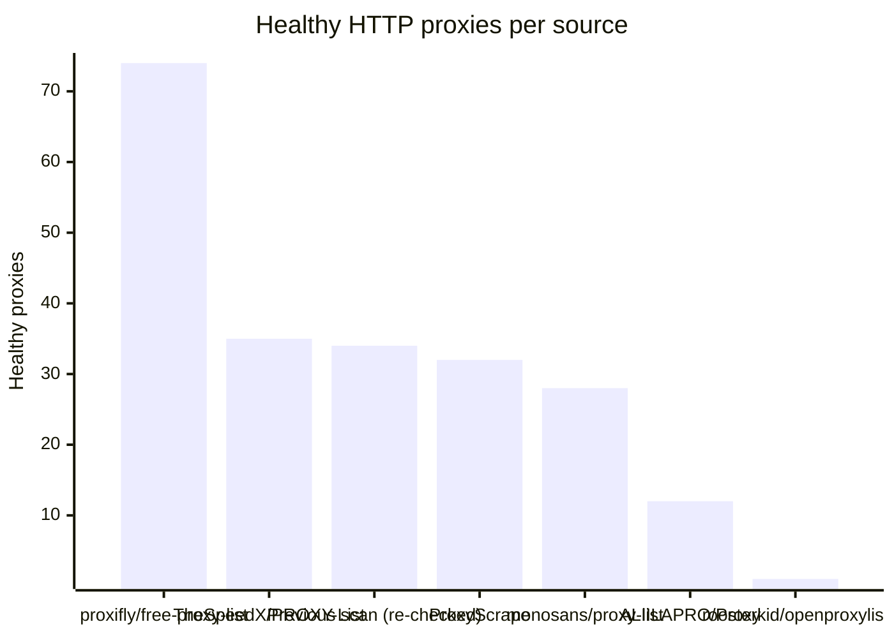
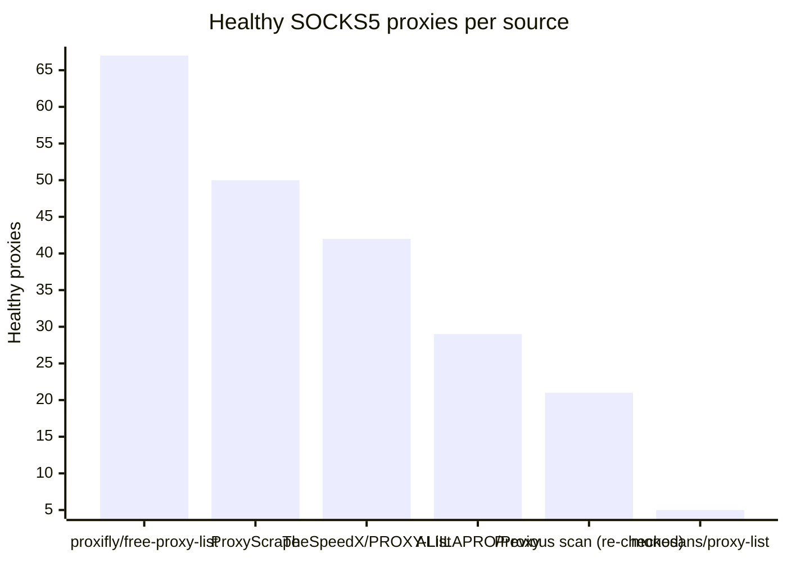

# Proxy Configs

<!-- dynamic timestamp placeholders for workflow sed script -->
channel_stats_chart.svg?v=1794960246
performance_report.html?v=1794960246

### Performance Chart

### Performance Report
[View Report](assets/performance_report.html?v=1794960246)

## HTTP

<!-- STATS:HTTP:START -->

_Last updated: 2026-11-17 18:13 UTC_

| Source | Healthy proxies |
|---|---|
| proxifly/free-proxy-list | 74 |
| TheSpeedX/PROXY-List | 35 |
| Previous scan (re-checked) | 34 |
| ProxyScrape | 32 |
| monosans/proxy-list | 28 |
| ALIILAPRO/Proxy | 12 |
| roosterkid/openproxylist | 1 |
| **Total unique** | **216** |

<!-- STATS:HTTP:END -->

## SOCKS5

<!-- STATS:SOCKS5:START -->

_Last updated: 2026-11-17 18:13 UTC_

| Source | Healthy proxies |
|---|---|
| proxifly/free-proxy-list | 67 |
| ProxyScrape | 50 |
| TheSpeedX/PROXY-List | 42 |
| ALIILAPRO/Proxy | 29 |
| Previous scan (re-checked) | 21 |
| monosans/proxy-list | 5 |
| **Total unique** | **214** |

<!-- STATS:SOCKS5:END -->
