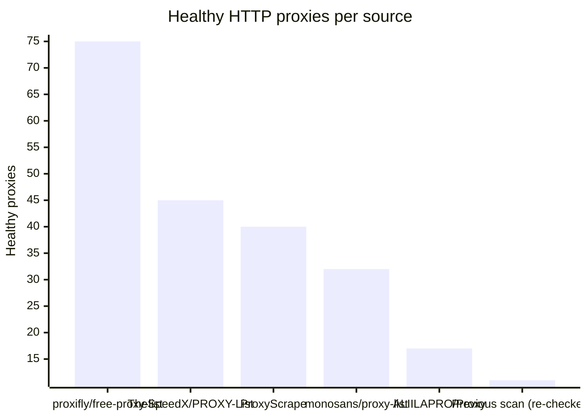
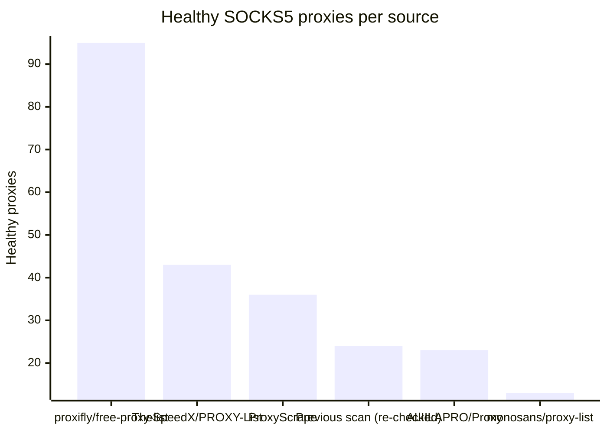

# Proxy Configs

<!-- dynamic timestamp placeholders for workflow sed script -->
channel_stats_chart.svg?v=1792044211
performance_report.html?v=1792044211

### Performance Chart

### Performance Report
[View Report](assets/performance_report.html?v=1792044211)

## HTTP

<!-- STATS:HTTP:START -->

_Last updated: 2026-10-15 00:23 UTC_

| Source | Healthy proxies |
|---|---|
| proxifly/free-proxy-list | 75 |
| TheSpeedX/PROXY-List | 45 |
| ProxyScrape | 40 |
| monosans/proxy-list | 32 |
| ALIILAPRO/Proxy | 17 |
| Previous scan (re-checked) | 11 |
| **Total unique** | **220** |

<!-- STATS:HTTP:END -->

## SOCKS5

<!-- STATS:SOCKS5:START -->

_Last updated: 2026-10-15 00:23 UTC_

| Source | Healthy proxies |
|---|---|
| proxifly/free-proxy-list | 95 |
| TheSpeedX/PROXY-List | 43 |
| ProxyScrape | 36 |
| Previous scan (re-checked) | 24 |
| ALIILAPRO/Proxy | 23 |
| monosans/proxy-list | 13 |
| **Total unique** | **234** |

<!-- STATS:SOCKS5:END -->
