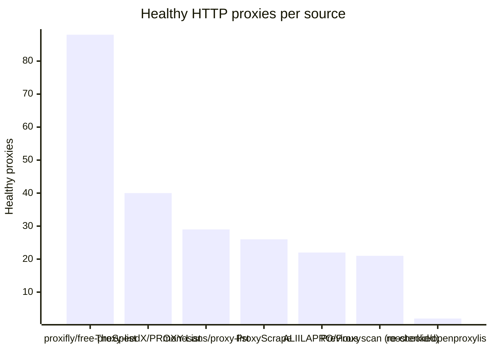
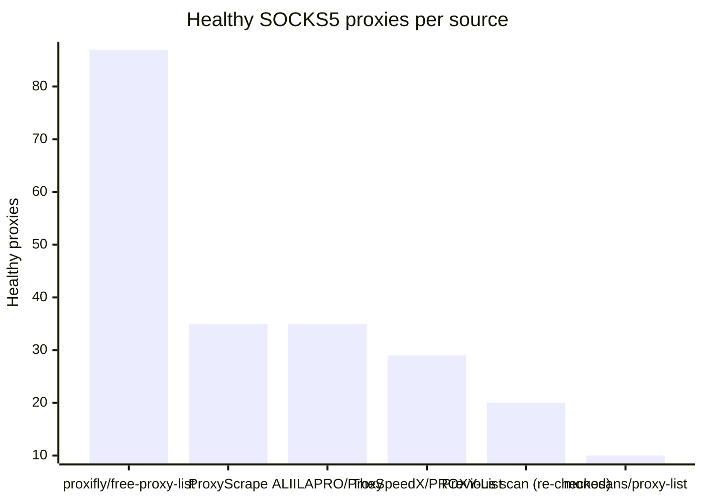

# Proxy Configs

<!-- dynamic timestamp placeholders for workflow sed script -->
channel_stats_chart.svg?v=1791936152
performance_report.html?v=1791936152

### Performance Chart

### Performance Report
[View Report](assets/performance_report.html?v=1791936152)

## HTTP

<!-- STATS:HTTP:START -->

_Last updated: 2026-10-13 18:25 UTC_

| Source | Healthy proxies |
|---|---|
| proxifly/free-proxy-list | 88 |
| TheSpeedX/PROXY-List | 40 |
| monosans/proxy-list | 29 |
| ProxyScrape | 26 |
| ALIILAPRO/Proxy | 22 |
| Previous scan (re-checked) | 21 |
| roosterkid/openproxylist | 2 |
| **Total unique** | **228** |

<!-- STATS:HTTP:END -->

## SOCKS5

<!-- STATS:SOCKS5:START -->

_Last updated: 2026-10-13 18:25 UTC_

| Source | Healthy proxies |
|---|---|
| proxifly/free-proxy-list | 87 |
| ProxyScrape | 35 |
| ALIILAPRO/Proxy | 35 |
| TheSpeedX/PROXY-List | 29 |
| Previous scan (re-checked) | 20 |
| monosans/proxy-list | 10 |
| **Total unique** | **216** |

<!-- STATS:SOCKS5:END -->
