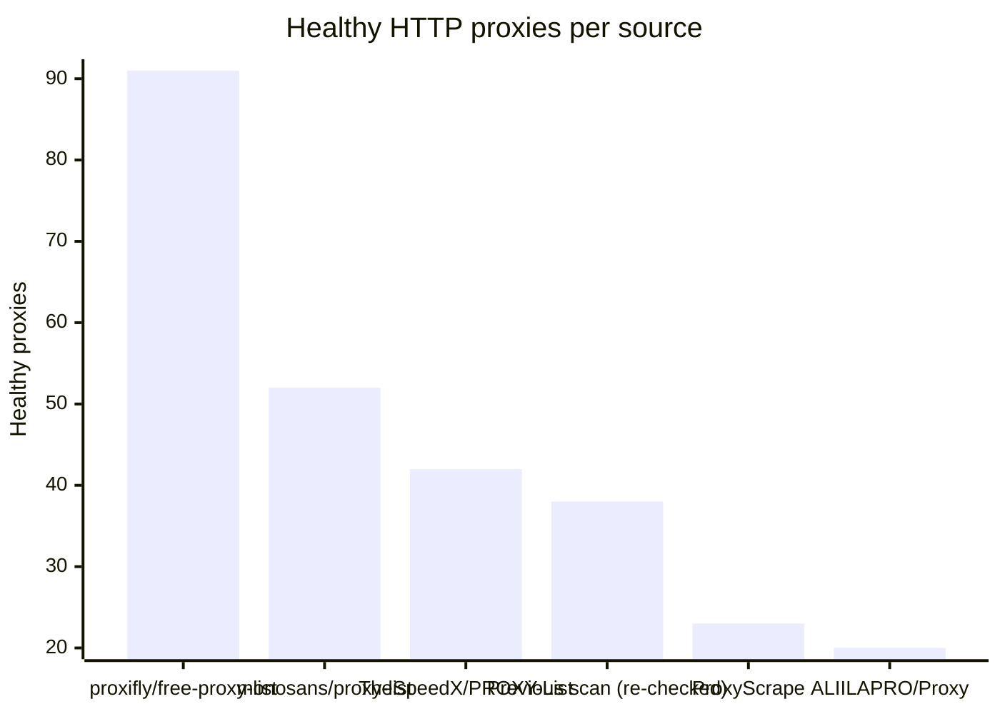
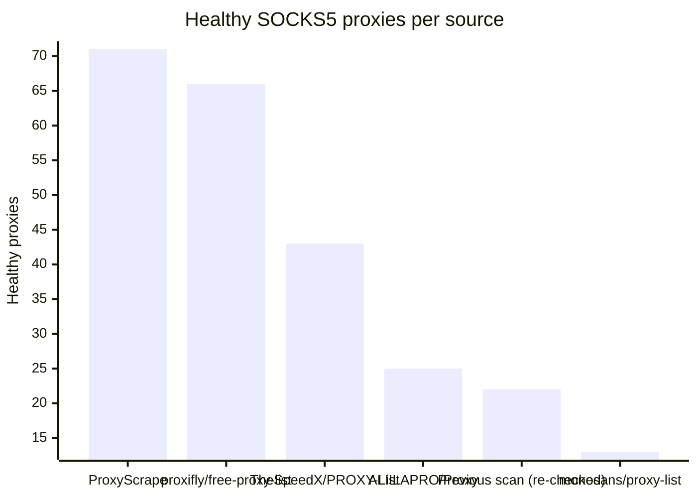

# Proxy Configs

<!-- dynamic timestamp placeholders for workflow sed script -->
channel_stats_chart.svg?v=1794376956
performance_report.html?v=1794376956

### Performance Chart

### Performance Report
[View Report](assets/performance_report.html?v=1794376956)

## HTTP

<!-- STATS:HTTP:START -->

_Last updated: 2026-11-11 00:14 UTC_

| Source | Healthy proxies |
|---|---|
| proxifly/free-proxy-list | 91 |
| monosans/proxy-list | 52 |
| TheSpeedX/PROXY-List | 42 |
| Previous scan (re-checked) | 38 |
| ProxyScrape | 23 |
| ALIILAPRO/Proxy | 20 |
| **Total unique** | **266** |

<!-- STATS:HTTP:END -->

## SOCKS5

<!-- STATS:SOCKS5:START -->

_Last updated: 2026-11-11 00:14 UTC_

| Source | Healthy proxies |
|---|---|
| ProxyScrape | 71 |
| proxifly/free-proxy-list | 66 |
| TheSpeedX/PROXY-List | 43 |
| ALIILAPRO/Proxy | 25 |
| Previous scan (re-checked) | 22 |
| monosans/proxy-list | 13 |
| **Total unique** | **240** |

<!-- STATS:SOCKS5:END -->
