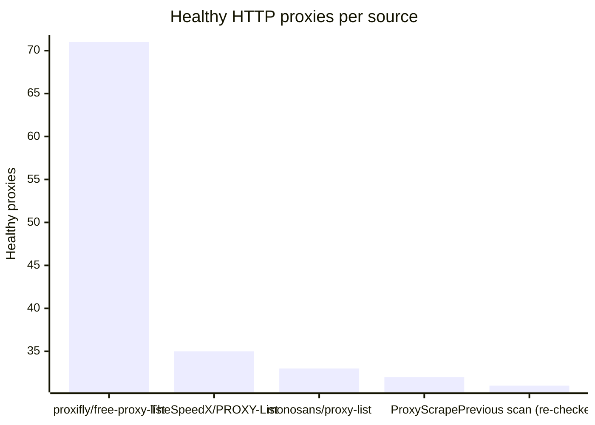
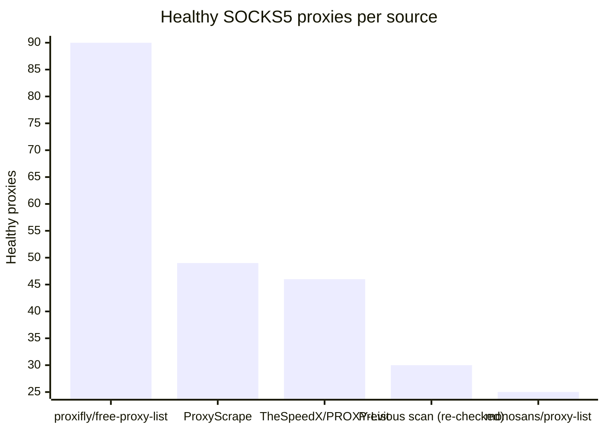

# Proxy Configs

<!-- dynamic timestamp placeholders for workflow sed script -->
channel_stats_chart.svg?v=1791914749
performance_report.html?v=1791914749

### Performance Chart

### Performance Report
[View Report](assets/performance_report.html?v=1791914749)

## HTTP

<!-- STATS:HTTP:START -->

_Last updated: 2026-10-13 12:24 UTC_

| Source | Healthy proxies |
|---|---|
| proxifly/free-proxy-list | 71 |
| TheSpeedX/PROXY-List | 35 |
| monosans/proxy-list | 33 |
| ProxyScrape | 32 |
| Previous scan (re-checked) | 31 |
| **Total unique** | **202** |

<!-- STATS:HTTP:END -->

## SOCKS5

<!-- STATS:SOCKS5:START -->

_Last updated: 2026-10-13 12:24 UTC_

| Source | Healthy proxies |
|---|---|
| proxifly/free-proxy-list | 90 |
| ProxyScrape | 49 |
| TheSpeedX/PROXY-List | 46 |
| Previous scan (re-checked) | 30 |
| monosans/proxy-list | 25 |
| **Total unique** | **240** |

<!-- STATS:SOCKS5:END -->
