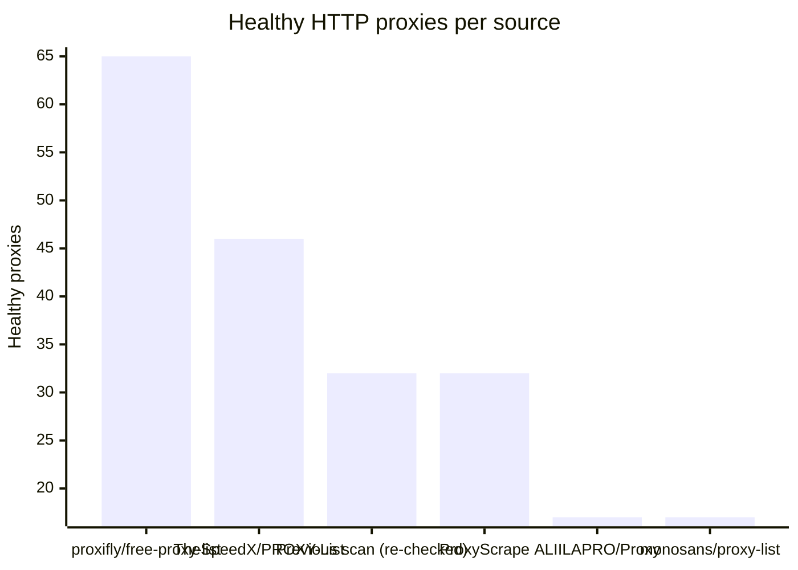
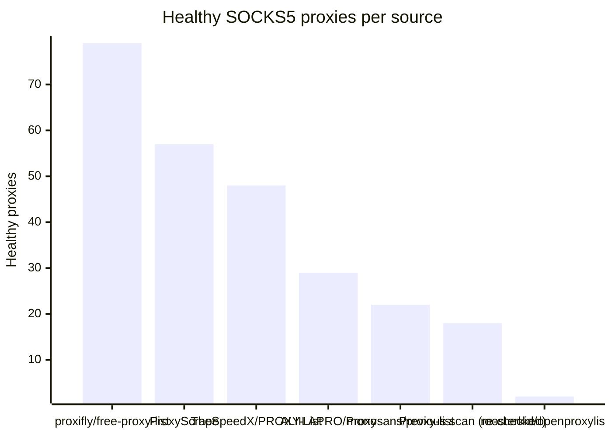

# Proxy Configs

<!-- dynamic timestamp placeholders for workflow sed script -->
channel_stats_chart.svg?v=1793361710
performance_report.html?v=1793361710

### Performance Chart

### Performance Report
[View Report](assets/performance_report.html?v=1793361710)

## HTTP

<!-- STATS:HTTP:START -->

_Last updated: 2026-10-30 06:13 UTC_

| Source | Healthy proxies |
|---|---|
| proxifly/free-proxy-list | 65 |
| TheSpeedX/PROXY-List | 46 |
| Previous scan (re-checked) | 32 |
| ProxyScrape | 32 |
| ALIILAPRO/Proxy | 17 |
| monosans/proxy-list | 17 |
| **Total unique** | **209** |

<!-- STATS:HTTP:END -->

## SOCKS5

<!-- STATS:SOCKS5:START -->

_Last updated: 2026-10-30 06:13 UTC_

| Source | Healthy proxies |
|---|---|
| proxifly/free-proxy-list | 79 |
| ProxyScrape | 57 |
| TheSpeedX/PROXY-List | 48 |
| ALIILAPRO/Proxy | 29 |
| monosans/proxy-list | 22 |
| Previous scan (re-checked) | 18 |
| roosterkid/openproxylist | 2 |
| **Total unique** | **255** |

<!-- STATS:SOCKS5:END -->
