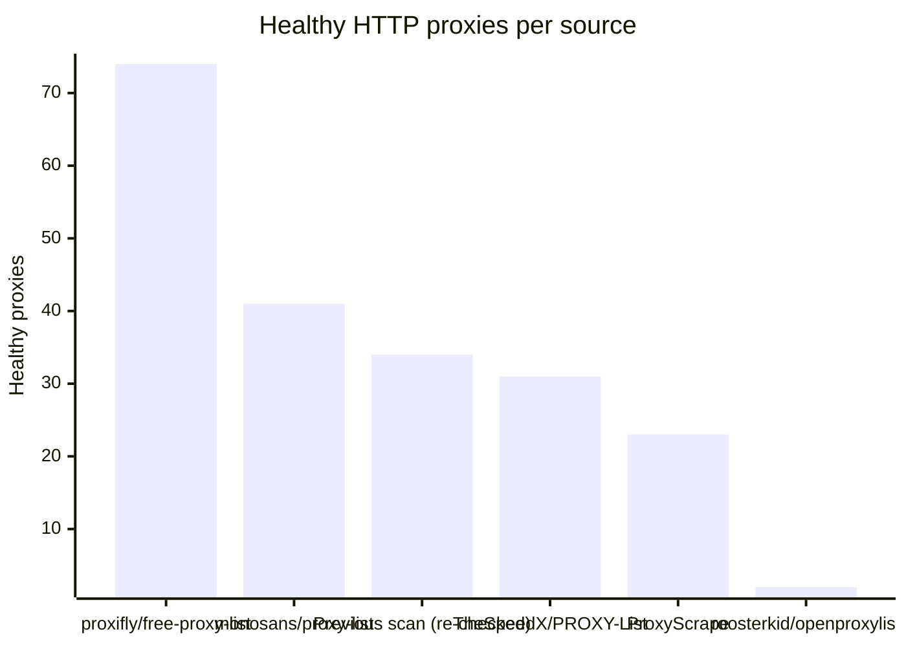
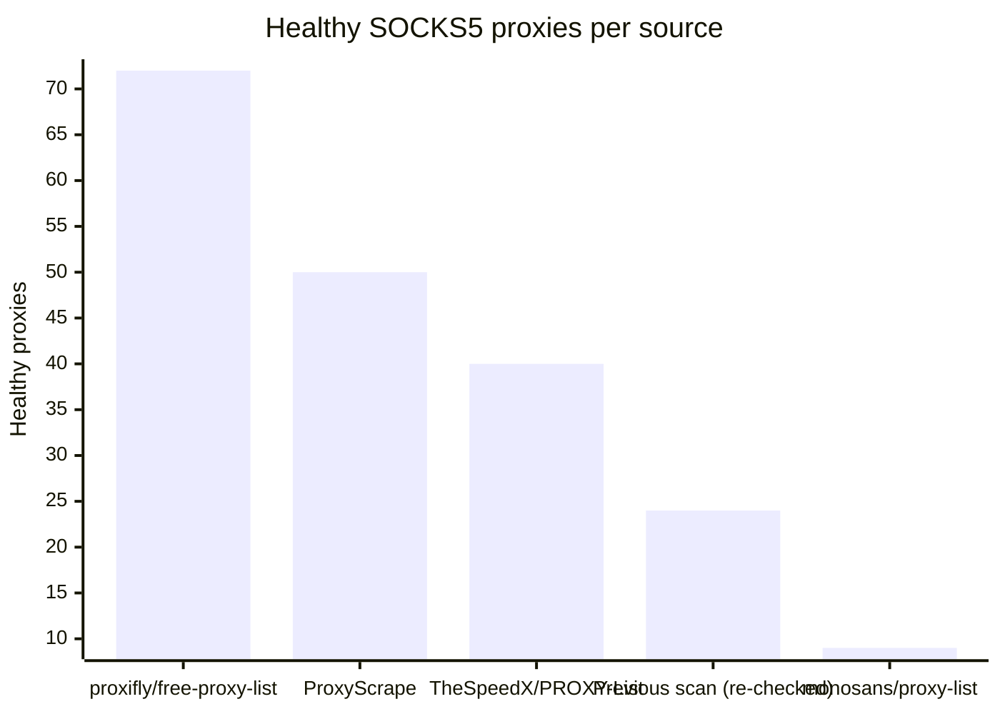

# Proxy Configs

<!-- dynamic timestamp placeholders for workflow sed script -->
channel_stats_chart.svg?v=1791309724
performance_report.html?v=1791309724

### Performance Chart

### Performance Report
[View Report](assets/performance_report.html?v=1791309724)

## HTTP

<!-- STATS:HTTP:START -->

_Last updated: 2026-11-17 12:12 UTC_

| Source | Healthy proxies |
|---|---|
| proxifly/free-proxy-list | 74 |
| monosans/proxy-list | 41 |
| Previous scan (re-checked) | 34 |
| TheSpeedX/PROXY-List | 31 |
| ProxyScrape | 23 |
| roosterkid/openproxylist | 2 |
| **Total unique** | **205** |

<!-- STATS:HTTP:END -->

## SOCKS5

<!-- STATS:SOCKS5:START -->

_Last updated: 2026-11-17 12:12 UTC_

| Source | Healthy proxies |
|---|---|
| proxifly/free-proxy-list | 72 |
| ProxyScrape | 50 |
| TheSpeedX/PROXY-List | 40 |
| Previous scan (re-checked) | 24 |
| monosans/proxy-list | 9 |
| **Total unique** | **195** |

<!-- STATS:SOCKS5:END -->
