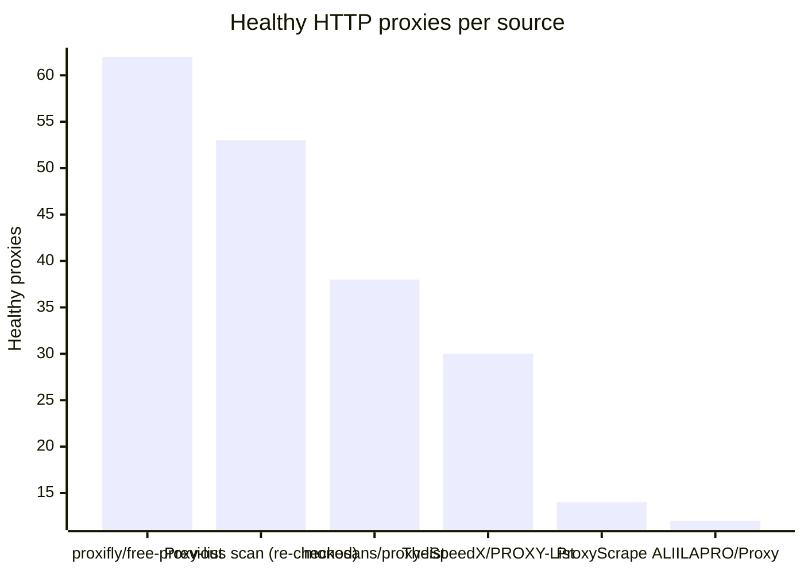
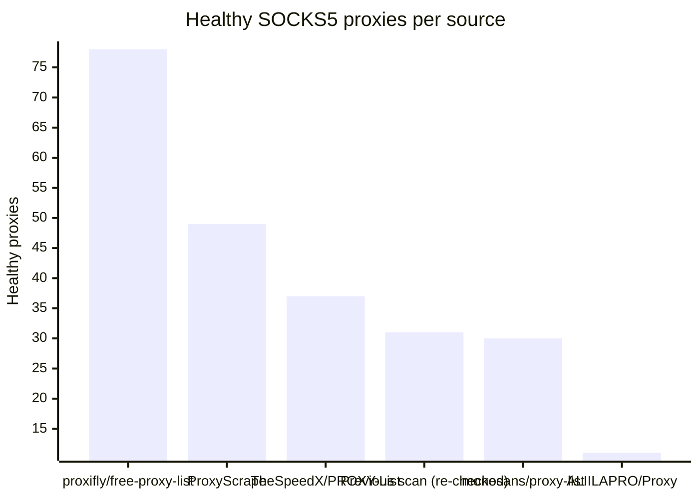

# Proxy Configs

<!-- dynamic timestamp placeholders for workflow sed script -->
channel_stats_chart.svg?v=1795867494
performance_report.html?v=1795867494

### Performance Chart

### Performance Report
[View Report](assets/performance_report.html?v=1795867494)

## HTTP

<!-- STATS:HTTP:START -->

_Last updated: 2026-11-28 06:12 UTC_

| Source | Healthy proxies |
|---|---|
| proxifly/free-proxy-list | 62 |
| Previous scan (re-checked) | 53 |
| monosans/proxy-list | 38 |
| TheSpeedX/PROXY-List | 30 |
| ProxyScrape | 14 |
| ALIILAPRO/Proxy | 12 |
| **Total unique** | **209** |

<!-- STATS:HTTP:END -->

## SOCKS5

<!-- STATS:SOCKS5:START -->

_Last updated: 2026-11-28 06:12 UTC_

| Source | Healthy proxies |
|---|---|
| proxifly/free-proxy-list | 78 |
| ProxyScrape | 49 |
| TheSpeedX/PROXY-List | 37 |
| Previous scan (re-checked) | 31 |
| monosans/proxy-list | 30 |
| ALIILAPRO/Proxy | 11 |
| **Total unique** | **236** |

<!-- STATS:SOCKS5:END -->
