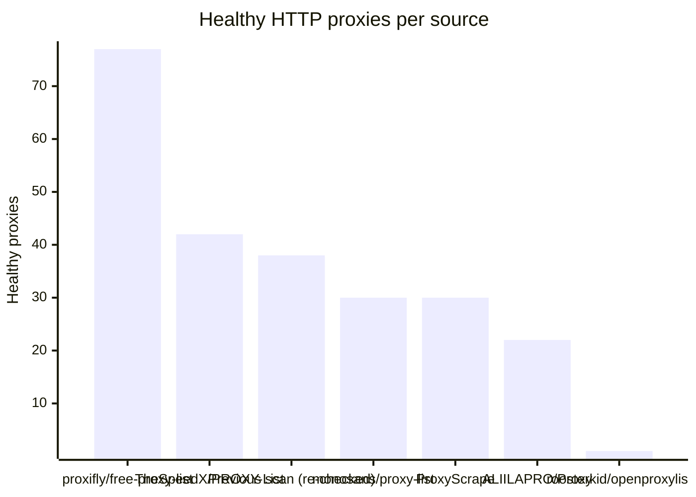
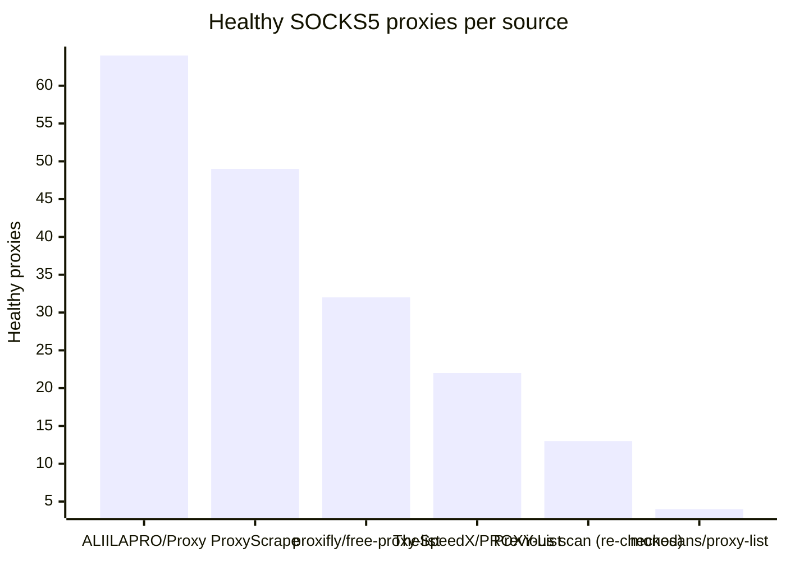

# Proxy Configs

<!-- dynamic timestamp placeholders for workflow sed script -->
channel_stats_chart.svg?v=1794333907
performance_report.html?v=1794333907

### Performance Chart

### Performance Report
[View Report](assets/performance_report.html?v=1794333907)

## HTTP

<!-- STATS:HTTP:START -->

_Last updated: 2026-11-10 12:15 UTC_

| Source | Healthy proxies |
|---|---|
| proxifly/free-proxy-list | 77 |
| TheSpeedX/PROXY-List | 42 |
| Previous scan (re-checked) | 38 |
| monosans/proxy-list | 30 |
| ProxyScrape | 30 |
| ALIILAPRO/Proxy | 22 |
| roosterkid/openproxylist | 1 |
| **Total unique** | **240** |

<!-- STATS:HTTP:END -->

## SOCKS5

<!-- STATS:SOCKS5:START -->

_Last updated: 2026-11-10 12:15 UTC_

| Source | Healthy proxies |
|---|---|
| ALIILAPRO/Proxy | 64 |
| ProxyScrape | 49 |
| proxifly/free-proxy-list | 32 |
| TheSpeedX/PROXY-List | 22 |
| Previous scan (re-checked) | 13 |
| monosans/proxy-list | 4 |
| **Total unique** | **184** |

<!-- STATS:SOCKS5:END -->
