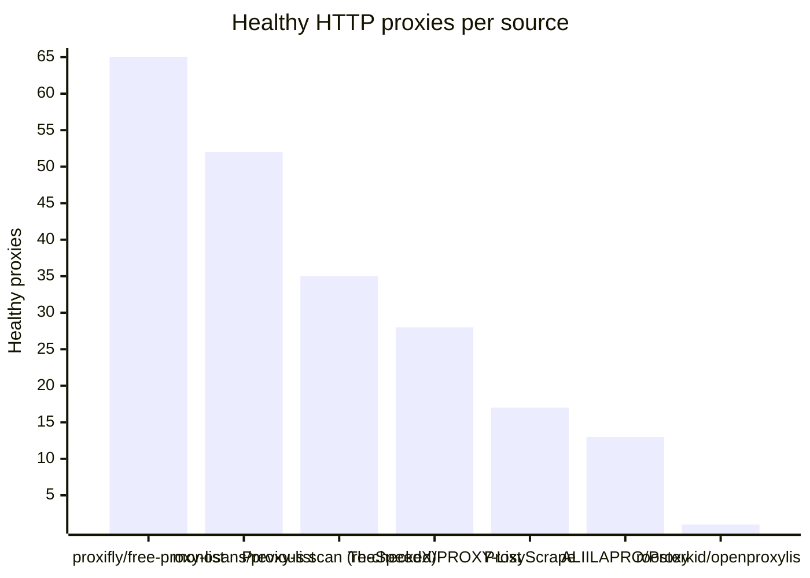
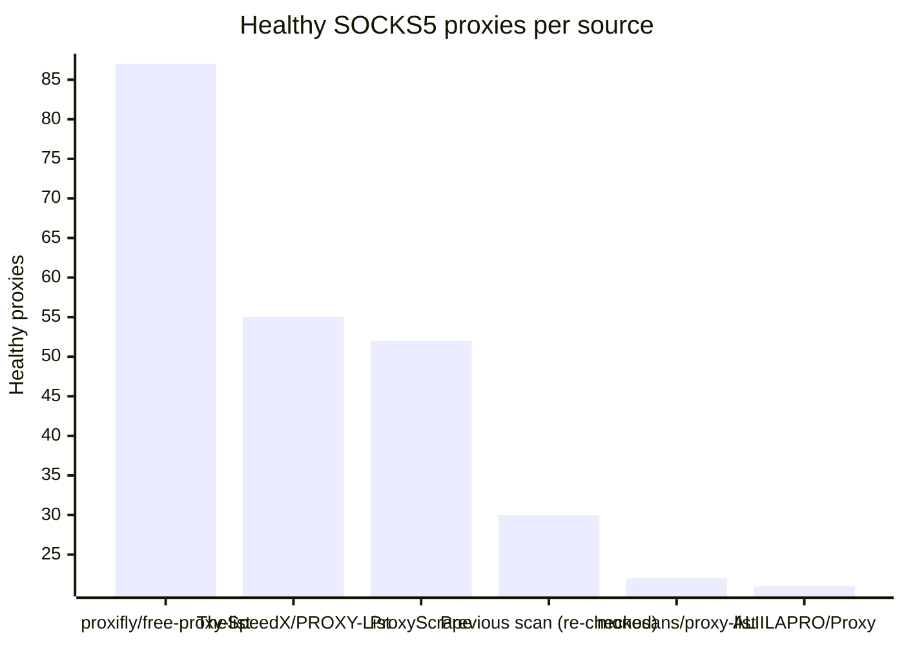

# Proxy Configs

<!-- dynamic timestamp placeholders for workflow sed script -->
channel_stats_chart.svg?v=1795780943
performance_report.html?v=1795780943

### Performance Chart

### Performance Report
[View Report](assets/performance_report.html?v=1795780943)

## HTTP

<!-- STATS:HTTP:START -->

_Last updated: 2026-11-27 06:13 UTC_

| Source | Healthy proxies |
|---|---|
| proxifly/free-proxy-list | 65 |
| monosans/proxy-list | 52 |
| Previous scan (re-checked) | 35 |
| TheSpeedX/PROXY-List | 28 |
| ProxyScrape | 17 |
| ALIILAPRO/Proxy | 13 |
| roosterkid/openproxylist | 1 |
| **Total unique** | **211** |

<!-- STATS:HTTP:END -->

## SOCKS5

<!-- STATS:SOCKS5:START -->

_Last updated: 2026-11-27 06:13 UTC_

| Source | Healthy proxies |
|---|---|
| proxifly/free-proxy-list | 87 |
| TheSpeedX/PROXY-List | 55 |
| ProxyScrape | 52 |
| Previous scan (re-checked) | 30 |
| monosans/proxy-list | 22 |
| ALIILAPRO/Proxy | 21 |
| **Total unique** | **267** |

<!-- STATS:SOCKS5:END -->
