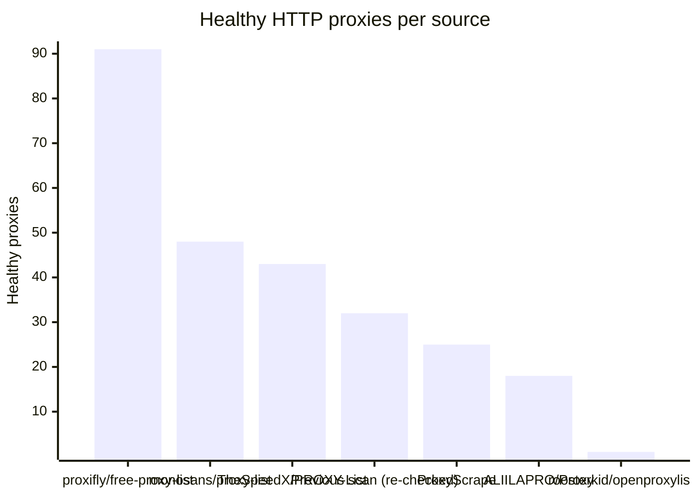
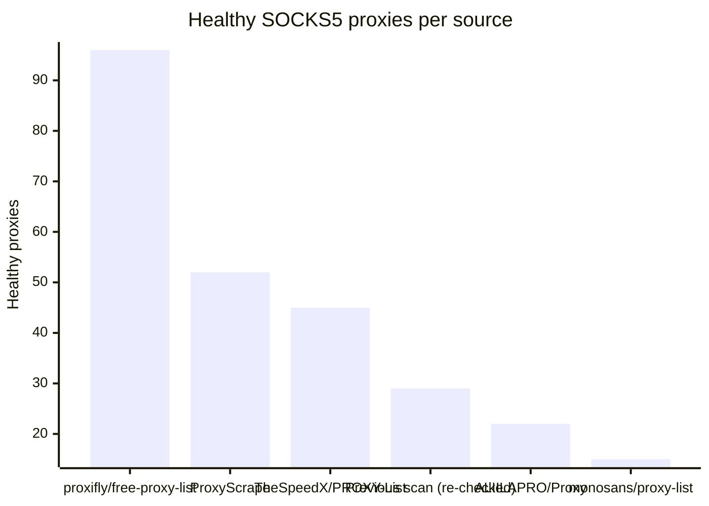

# Proxy Configs

<!-- dynamic timestamp placeholders for workflow sed script -->
channel_stats_chart.svg?v=1792497887
performance_report.html?v=1792497887

### Performance Chart

### Performance Report
[View Report](assets/performance_report.html?v=1792497887)

## HTTP

<!-- STATS:HTTP:START -->

_Last updated: 2026-10-20 06:23 UTC_

| Source | Healthy proxies |
|---|---|
| proxifly/free-proxy-list | 91 |
| monosans/proxy-list | 48 |
| TheSpeedX/PROXY-List | 43 |
| Previous scan (re-checked) | 32 |
| ProxyScrape | 25 |
| ALIILAPRO/Proxy | 18 |
| roosterkid/openproxylist | 1 |
| **Total unique** | **258** |

<!-- STATS:HTTP:END -->

## SOCKS5

<!-- STATS:SOCKS5:START -->

_Last updated: 2026-10-20 06:23 UTC_

| Source | Healthy proxies |
|---|---|
| proxifly/free-proxy-list | 96 |
| ProxyScrape | 52 |
| TheSpeedX/PROXY-List | 45 |
| Previous scan (re-checked) | 29 |
| ALIILAPRO/Proxy | 22 |
| monosans/proxy-list | 15 |
| **Total unique** | **259** |

<!-- STATS:SOCKS5:END -->
