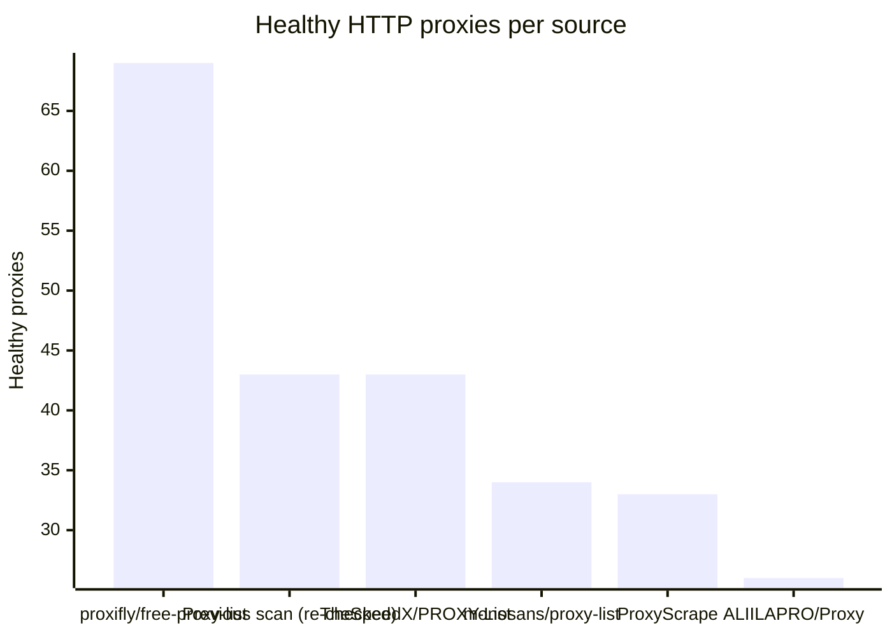
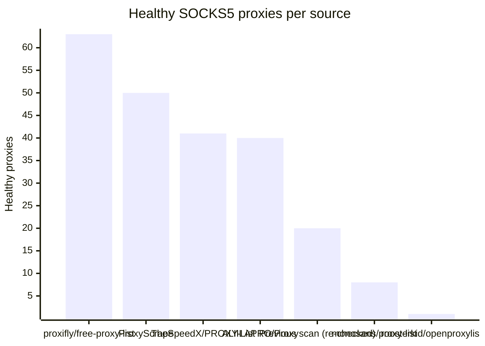

# Proxy Configs

<!-- dynamic timestamp placeholders for workflow sed script -->
channel_stats_chart.svg?v=1794787355
performance_report.html?v=1794787355

### Performance Chart

### Performance Report
[View Report](assets/performance_report.html?v=1794787355)

## HTTP

<!-- STATS:HTTP:START -->

_Last updated: 2026-11-15 18:13 UTC_

| Source | Healthy proxies |
|---|---|
| proxifly/free-proxy-list | 69 |
| Previous scan (re-checked) | 43 |
| TheSpeedX/PROXY-List | 43 |
| monosans/proxy-list | 34 |
| ProxyScrape | 33 |
| ALIILAPRO/Proxy | 26 |
| **Total unique** | **248** |

<!-- STATS:HTTP:END -->

## SOCKS5

<!-- STATS:SOCKS5:START -->

_Last updated: 2026-11-15 18:13 UTC_

| Source | Healthy proxies |
|---|---|
| proxifly/free-proxy-list | 63 |
| ProxyScrape | 50 |
| TheSpeedX/PROXY-List | 41 |
| ALIILAPRO/Proxy | 40 |
| Previous scan (re-checked) | 20 |
| monosans/proxy-list | 8 |
| roosterkid/openproxylist | 1 |
| **Total unique** | **223** |

<!-- STATS:SOCKS5:END -->
