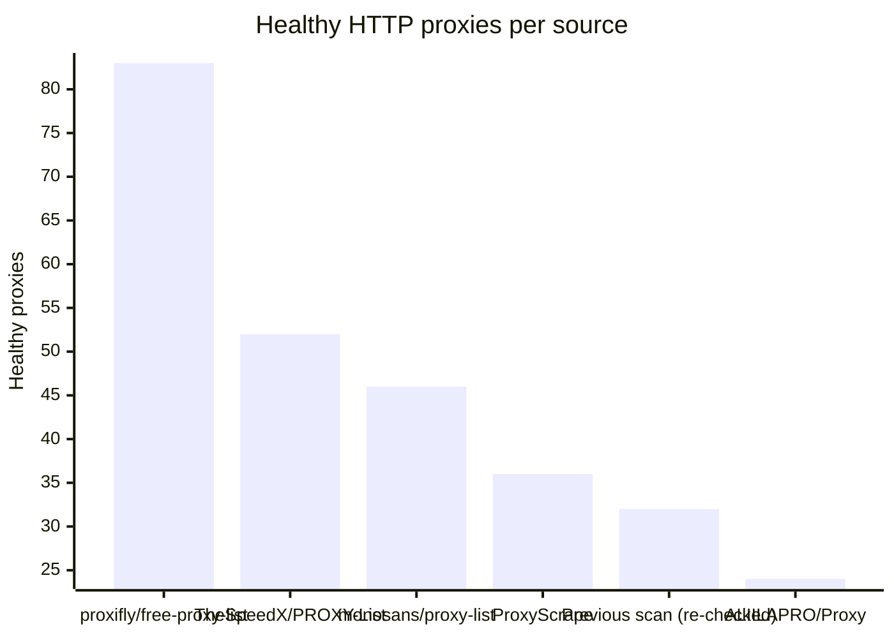
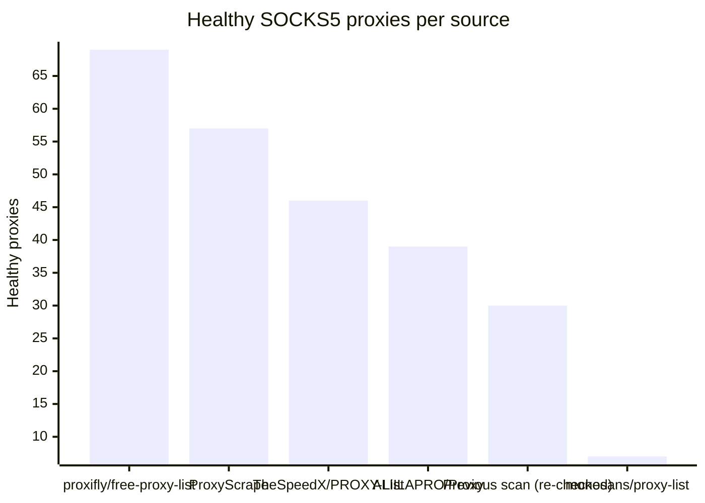

# Proxy Configs

<!-- dynamic timestamp placeholders for workflow sed script -->
channel_stats_chart.svg?v=1794117819
performance_report.html?v=1794117819

### Performance Chart

### Performance Report
[View Report](assets/performance_report.html?v=1794117819)

## HTTP

<!-- STATS:HTTP:START -->

_Last updated: 2026-11-08 00:15 UTC_

| Source | Healthy proxies |
|---|---|
| proxifly/free-proxy-list | 83 |
| TheSpeedX/PROXY-List | 52 |
| monosans/proxy-list | 46 |
| ProxyScrape | 36 |
| Previous scan (re-checked) | 32 |
| ALIILAPRO/Proxy | 24 |
| **Total unique** | **273** |

<!-- STATS:HTTP:END -->

## SOCKS5

<!-- STATS:SOCKS5:START -->

_Last updated: 2026-11-08 00:15 UTC_

| Source | Healthy proxies |
|---|---|
| proxifly/free-proxy-list | 69 |
| ProxyScrape | 57 |
| TheSpeedX/PROXY-List | 46 |
| ALIILAPRO/Proxy | 39 |
| Previous scan (re-checked) | 30 |
| monosans/proxy-list | 7 |
| **Total unique** | **248** |

<!-- STATS:SOCKS5:END -->
